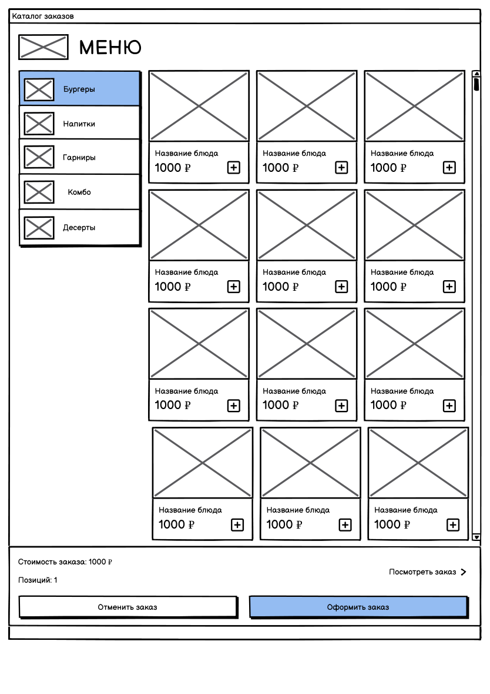
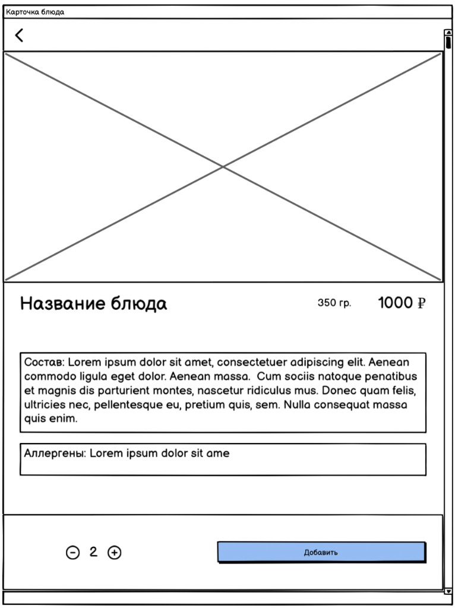
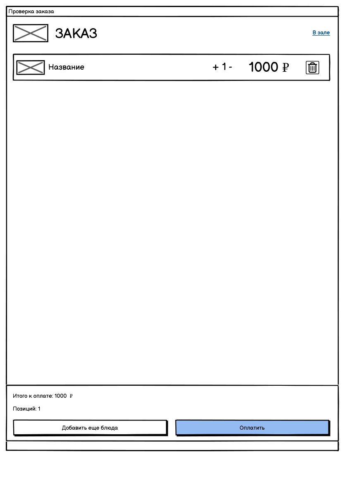
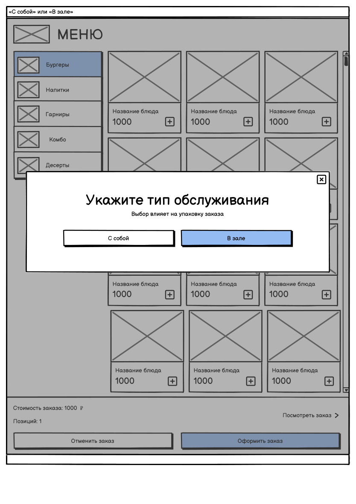
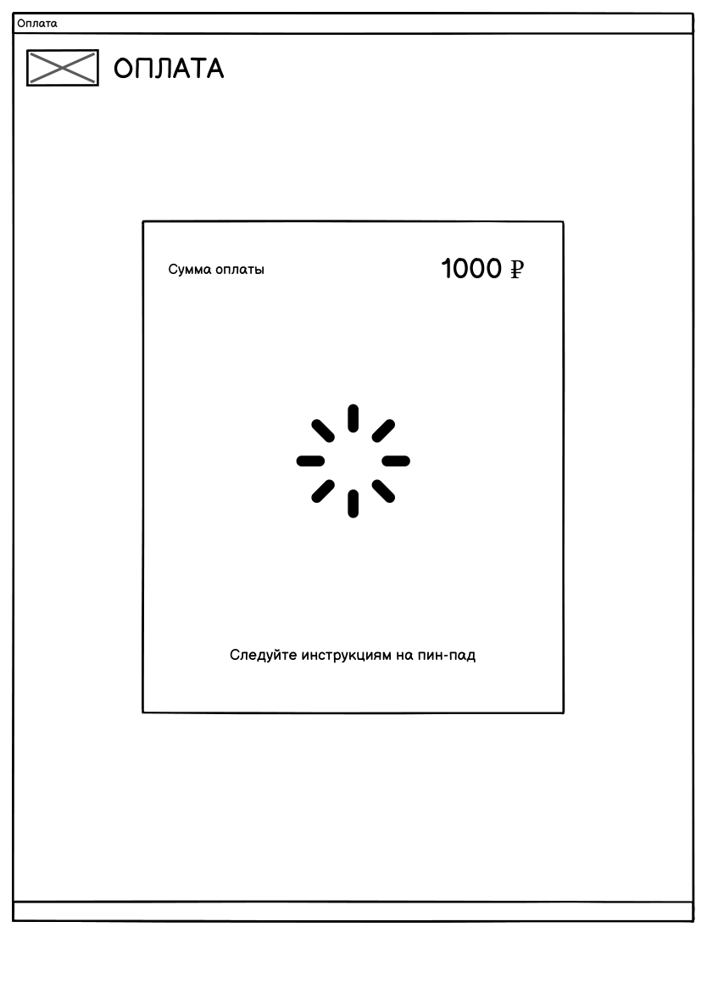
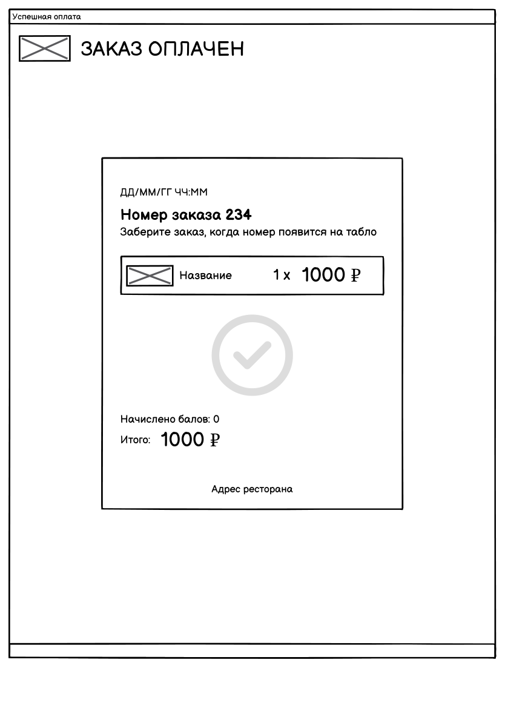
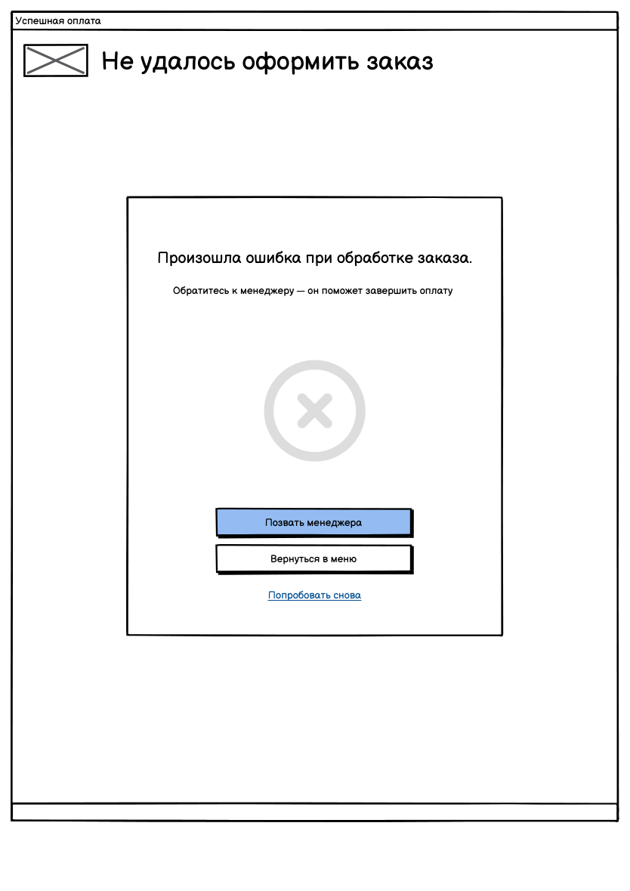

# Декомпозиция и критерии приемки

---

## Декомпозиция истории

**Исходная история (MVP):**

> Я как посетитель хочу добавлять выбранные позиции в корзину и видеть текущую сумму, чтобы контролировать состав и стоимость заказа.

### По этапам сценария

| Срез | Формулировка                                                                                                                          | Ценность для гостя                          |
| ---- | ------------------------------------------------------------------------------------------------------------------------------------- | ------------------------------------------- |
| A1   | Я как посетитель хочу добавить первое блюдо и сразу увидеть сумму на каталоге, чтобы заказ начался и цена была видна без перехода дальше | Заказ появился, сумма уже известна          |
| A2   | Я как посетитель хочу открыть проверку заказа и увидеть состав и итог, чтобы сверить заказ до оплаты                                  | Перед оплатой виден весь заказ              |
| A3   | Я как посетитель хочу поправить состав на проверке заказа и увидеть новый итог, чтобы оплатить уже исправленный заказ                 | Ошибку можно убрать до оплаты               |

### По составу заказа

| Срез | Формулировка                                                                                                                                        | Ценность для гостя                         |
| ---- | --------------------------------------------------------------------------------------------------------------------------------------------------- | ------------------------------------------ |
| B1   | Я как посетитель хочу добавить одну порцию одного блюда и увидеть сумму, равную его цене, чтобы проверить цену перед тем как собирать заказ дальше | Цена в корзине совпадает с ценой в меню    |
| B2   | Я как посетитель хочу взять несколько порций одного блюда и увидеть стоимость строки как цену, умноженную на количество, чтобы не считать порции самому | Стоимость растет вместе с числом порций    |
| B3   | Я как посетитель хочу собрать несколько разных блюд и увидеть итог как сумму строк, чтобы понимать стоимость всего заказа, а не каждого блюда отдельно | Итог собирается из разных позиций          |

### По потребностям гостя

| Срез | Формулировка                                                                                               | Ценность для гостя       |
| ---- | ---------------------------------------------------------------------------------------------------------- | ------------------------ |
| C1   | Я как посетитель хочу видеть список выбранных блюд, чтобы понимать, из чего состоит заказ                  | Контроль состава         |
| C2   | Я как посетитель хочу задавать количество каждой позиции, чтобы заказать нужное число порций каждого блюда | Контроль количества      |
| C3   | Я как посетитель хочу видеть итоговую сумму заказа до оплаты, чтобы решить, устраивает ли стоимость        | Контроль суммы до оплаты |

---

## Критерии приемки

### Меню и актуальные цены

> Я как посетитель хочу ознакомиться с меню и увидеть актуальные цены, чтобы выбрать подходящие блюда для заказа.

**AC-1.1. Каталог после старта сессии**

- **G** гость подошел к свободному киоску, торговый день открыт, в меню есть категории и позиции с ценами текущего дня
- **W** гость начинает сессию на киоске
- **T** открывается экран «Каталог заказов»: видны категории (Бургеры, Напитки, Гарниры, Комбо, Десерты) и позиции с названием и ценой в рублях

**AC-1.2. Цена на карточке совпадает с ценой в каталоге**

- **G** в каталоге отображается позиция с ценой текущего торгового дня
- **W** гость открывает карточку этой позиции
- **T** на карточке показаны название, вес, состав, аллергены и та же цена, что в каталоге

**AC-1.3. Новая сессия берет меню текущего дня**

- **G** предыдущая сессия завершена (оплата, отмена или таймаут), торговый день открыт, в меню дня есть цены
- **W** следующий гость начинает сессию
- **T** видны категории и цены текущего торгового дня, выбранная категория предыдущего гостя на экране не остается

### Корзина и текущая сумма

> Я как посетитель хочу добавлять выбранные позиции в корзину и видеть текущую сумму, чтобы контролировать состав и стоимость заказа.

«Позиций» везде в этих критериях — сумма количеств строк, не число строк.

**AC-2.1. Добавление с карточки блюда**

- **G** корзина пуста, в каталоге есть доступная позиция с ценой, на карточке количество по умолчанию 1
- **W** гость нажимает «Добавить»
- **T** открывается каталог, в блоке заказа показаны «Позиций: 1» и «Стоимость заказа», равная цене позиции

**AC-2.2. Удаление позиции пересчитывает сумму**

- **G** в корзине две разные позиции, на экране «Проверка заказа» виден список и итог
- **W** гость удаляет одну позицию («−» при количестве 1)
- **T** позиция пропадает из списка, «Позиций» уменьшается на ее количество, «Итого к оплате» равно сумме оставшихся строк (цена × количество)

**AC-2.3. Состав виден до оплаты**

- **G** гость добавил одну или несколько позиций и указал тип заказа
- **W** гость открывает экран «Проверка заказа»
- **T** до перехода к оплате видны название каждой позиции, количество, сумма строки (цена × количество) и «Итого к оплате»

**AC-2.4. Изменение количества пересчитывает строку и итог**

- **G** на экране «Проверка заказа» одна строка с количеством больше 0 и известной ценой
- **W** гость нажимает «+» либо «−» при количестве больше 1
- **T** «+» увеличивает количество на 1, «−» уменьшает количество на 1; сумма строки равна цена × новое количество, «Позиций» и «Итого к оплате» пересчитаны по всем строкам

### «В зале» или «на вынос»

> Я как посетитель хочу указать, что заказ «в зале» или «на вынос», чтобы получить еду удобным способом.

На макете подписи: «С собой» и «В зале». «С собой» = «на вынос».

**AC-3.1. Выбор типа на экране обслуживания**

- **G** в корзине есть хотя бы одна позиция, тип заказа еще не выбран
- **W** гость нажимает «Оформить заказ» на каталоге
- **T** открывается шаг «Укажите тип обслуживания» с вариантами «С собой» и «В зале» и пояснением «Выбор влияет на упаковку заказа»; экран «Оплата» не открывается

**AC-3.2. Выбранный тип виден на проверке заказа**

- **G** гость выбрал «В зале» или «С собой»
- **W** открывается экран «Проверка заказа»
- **T** на экране показана подпись выбранного типа: «В зале» или «С собой»

**AC-3.3. Оплата доступна после выбора типа**

- **G** на экране «Проверка заказа» уже указан тип «С собой» или «В зале»
- **W** гость нажимает «Оплатить»
- **T** открывается экран «Оплата»

### Оплата картой и талон

> Я как посетитель хочу оплатить заказ банковской картой и получить талон с номером, чтобы забрать заказ после приготовления.

**AC-4.1. Сумма на оплате совпадает с итогом проверки**

- **G** на экране «Проверка заказа» отображается «Итого к оплате», тип заказа выбран
- **W** гость нажимает «Оплатить»
- **T** открывается экран «Оплата» с той же суммой и текстом «Следуйте инструкциям на пин-пад»

**AC-4.2. Успешная оплата выдает номер заказа**

- **G** гость на экране «Оплата», пин-пад готов принять карту, сумма больше нуля
- **W** банк подтверждает оплату
- **T** открывается экран «Заказ оплачен»: дата и время, сумма, номер заказа, состав, итог и текст «Заберите заказ, когда номер появится на табло»

**AC-4.3. Отказ банка оставляет заказ неоплаченным**

- **G** гость на экране «Оплата», сумма больше нуля
- **W** банк отклоняет оплату
- **T** открывается экран «Не удалось оформить заказ» с текстом об ошибке и действиями «Позвать менеджера», «Вернуться в меню», «Попробовать снова»; номер заказа не выдается, заказ не уходит на приготовление и остается неоплаченным; «Попробовать снова» возвращает на «Оплату» с той же суммой и тем же составом; «Вернуться в меню» возвращает в каталог, корзина и тип заказа сохраняются

---

## Задачи разработчикам

### Меню и актуальные цены

#### Задача 1. Показать каталог меню с категориями и ценами

Каталог заказов:

**Бэкенд**

- **Метод:** `GET /menu`.
- **Запрос:** дата торгового дня. Если дата не передана, берется открытый день.
- **Ответ:** список категорий и блюд. У блюда — идентификатор, название, цена, признак доступности. В каталог попадают только доступные блюда активного меню, у которого текущая дата входит в период действия.
- **Таблицы:** `Меню` (наименование, тип, дата начала, дата окончания, активно), `Категория` (наименование, порядок отображения), `Товар` (наименование, стоимость, доступен). Связь: меню содержит категории, категория содержит товары.

**Фронт**

- **Экран:** «Каталог заказов».
- **Поля:** название категории; название блюда; цена блюда, ₽; подпись «МЕНЮ».
- **Функции:** при старте сессии вызвать `GET /menu`; вывести категории «Бургеры», «Напитки», «Гарниры», «Комбо», «Десерты»; по выбору категории показать ее позиции с ценой; по умолчанию открыть первую категорию.

#### Задача 2. Открыть карточку блюда с ценой из каталога

Карточка блюда:

**Бэкенд**

- **Метод:** `GET /menu/items/{itemId}`.
- **Ответ:** название, цена, вес, состав, аллергены, ссылка на фото. Цена та же, что в `GET /menu` для этого блюда.
- **Таблицы:** `Товар` (добавить поля вес, состав, аллергены), `Фото_товара` (ссылка, основное фото).

**Фронт**

- **Экран:** «Карточка блюда». Открывается с «Каталога заказов» по нажатию на позицию.
- **Поля:** фото; название; вес; цена, ₽; состав; аллергены.
- **Функции:** показать данные из `GET /menu/items/{itemId}`, цена совпадает с каталогом; «‹» возвращает в каталог без изменения корзины. Кнопки «−», «+» и «Добавить» относятся к задаче 4.

#### Задача 3. Обновить каталог при новой сессии

**Бэкенд**

- **Метод:** тот же `GET /menu`. Отдельная таблица сессии киоска не создается: выбранная категория в базе не хранится.
- **Правило:** ответ строится по открытому торговому дню, а не по ценам прошлого запроса.

**Фронт**

- **Экран:** «Каталог заказов».
- **Поля:** категория, название блюда, цена.
- **Функции:** при завершении сессии (оплата, отмена, таймаут) сбросить выбранную категорию и корзину на экране; при следующей сессии снова вызвать `GET /menu`.

### Корзина и текущая сумма

#### Задача 4. Добавить порции с карточки блюда и показать сумму на каталоге

**Бэкенд**

- **Методы:** `POST /carts` при старте сессии; `POST /carts/{cartId}/items` по «Добавить».
- **Тело добавления:** идентификатор блюда, количество.
- **Правило:** если такое блюдо уже есть в корзине, количество суммируется, вторая строка не создается. Цена строки берется из `Товар` на момент добавления. Сумма строки = цена × количество. В ответе — строки, число позиций (сумма количеств) и итог.
- **Таблицы:** `Корзина` (статус, количество товаров, общая сумма, дата создания), `Позиция_корзины` (количество, цена за единицу, сумма позиции).

**Фронт**

- **Экраны:** «Карточка блюда» и «Каталог заказов». Блок внизу каталога: «Стоимость заказа», «Позиций», «Посмотреть заказ».
- **Поля:** на карточке — количество порций (по умолчанию 1), цена, ₽; на каталоге — стоимость заказа, ₽; «Позиций» (сумма количеств всех строк).
- **Функции:** «−» и «+» на карточке меняют количество до нажатия «Добавить», минимум 1; «Добавить» вызывает `POST /carts/{cartId}/items` и возвращает в каталог; блок на каталоге показывает сумму и число позиций из ответа. С каталога отдельного добавления «+1» нет.

#### Задача 5. Показать состав корзины перед оплатой

**Бэкенд**

- **Метод:** `GET /carts/{cartId}`.
- **Ответ:** строки (название, количество, сумма строки), число позиций, итог, способ получения, если он уже записан.

**Фронт**

- **Экран:** «Проверка заказа».
- **Поля:** название позиции; количество; сумма строки, ₽; «Позиций»; «Итого к оплате»; выбранный тип («В зале» / «С собой»), если он уже указан.
- **Функции:** открыть экран по «Посмотреть заказ» или после выбора типа и вызвать `GET /carts/{cartId}`; вывести строки из ответа; оставить действия «Добавить еще блюда» (возврат в каталог с той же корзиной) и «Оплатить».

#### Задача 6. Изменить количество и удалить позицию на проверке заказа

**Бэкенд**

- **Методы:** `PATCH /carts/{cartId}/items/{lineId}` с новым количеством; `DELETE /carts/{cartId}/items/{lineId}`.
- **Правило:** количество меньше 1 не сохраняется, такая строка удаляется. После изменения пересчитать сумму строки, число позиций и общую сумму корзины. Пустая корзина возвращается с итогом 0.
- **Таблицы:** те же `Корзина` и `Позиция_корзины`.

**Фронт**

- **Экран:** «Проверка заказа», элементы «+» и «−» у строки.
- **Поля:** количество строки; сумма строки; «Позиций»; «Итого к оплате».
- **Функции:** «+» и «−» при количестве больше 1 вызывают `PATCH`; «−» при количестве 1 вызывает `DELETE`; после ответа обновить список и итог. Если строк не осталось, «Итого к оплате» = 0 и «Оплатить» недоступна.

### «В зале» или «на вынос»

#### Задача 7. Показать выбор типа обслуживания

**Бэкенд**

- Отдельный метод не нужен. Сумма и число позиций для шага берутся из `GET /carts/{cartId}`. Состав корзины на этом шаге не меняется.

**Фронт**

- **Экран:** «Укажите тип обслуживания» поверх каталога.
- **Поля:** заголовок «Укажите тип обслуживания»; кнопки «С собой» и «В зале»; пояснение «Выбор влияет на упаковку заказа»; стоимость и число позиций текущей корзины (только показ).
- **Функции:** открывать шаг по «Оформить заказ», если в корзине есть хотя бы одна позиция; закрыть шаг без сохранения типа, если гость вернулся в меню, не выбрав вариант. Экран «Оплата» с этого шага не открывается.

#### Задача 8. Сохранить выбранный тип и показать его на проверке заказа

**Бэкенд**

- **Метод:** `PATCH /carts/{cartId}`.
- **Тело:** `serviceType`: `takeaway` («С собой») или `dine_in` («В зале»).
- **Правило:** состав корзины метод не меняет. Пустое значение не записывается.
- **Таблицы:** в `Корзина` добавить поле способ получения.

**Фронт**

- **Экраны:** «Укажите тип обслуживания» и «Проверка заказа».
- **Поля:** тип заказа (`С собой` или `В зале`); на проверке — подпись выбранного типа рядом с составом.
- **Функции:** по нажатию «С собой» или «В зале» вызвать `PATCH /carts/{cartId}` и открыть «Проверку заказа»; на проверке показать ровно тот вариант, который нажал гость.

#### Задача 9. Не пускать к оплате без типа заказа

**Бэкенд**

- **Правило:** пока способ получения в `Корзина` пустой, `POST /carts/{cartId}/payment` не выполняется и возвращает отказ.

**Фронт**

- **Экраны:** «Каталог заказов», «Укажите тип обслуживания», «Проверка заказа», «Оплата».
- **Поля:** признак выбранного типа; кнопка «Оплатить» на проверке заказа.
- **Функции:** с каталога «Оформить заказ» ведет на выбор типа, а не на оплату; кнопка «Оплатить» на проверке активна только если тип уже записан; прямой переход на экран «Оплата» без типа не выполняется.

### Оплата картой и талон

#### Задача 10. Открыть оплату на сумму проверки заказа

**Бэкенд**

- **Метод:** `POST /carts/{cartId}/payment`.
- **Условие:** в корзине есть хотя бы одна позиция и заполнен способ получения.
- **Действие:** создать оплату на сумму корзины и платежную операцию со способом «карта». Номер заказа на этом шаге не присваивать. В ответе — сумма к оплате для экрана «Оплата» и пин-пада.
- **Таблицы:** `Оплата` (статус оплаты, сумма к оплате, дата начала), `Платежная_операция` (способ оплаты, сумма операции, статус операции, внешний номер транзакции).

**Фронт**

- **Экраны:** «Проверка заказа» и «Оплата».
- **Поля:** «Сумма оплаты», ₽; текст «Следуйте инструкциям на пин-пад».
- **Функции:** по «Оплатить» вызвать `POST /carts/{cartId}/payment` и показать сумму из ответа; состав на этом экране не менять; номер заказа не показывать до ответа банка.

#### Задача 11. Показать талон после успешной оплаты картой

**Бэкенд**

- **Метод:** `POST /payments/{paymentId}/result` с подтверждением банка.
- **Действие:** статус оплаты «оплачен», заказу присваивается уникальный номер, корзина переводится в заказ и уходит на приготовление.
- **Ответ:** номер заказа, дата и время, сумма, состав, итог, начислено баллов (0, если начисления не было).
- **Таблицы:** `Заказ` (номер заказа, способ получения, оплаченная сумма, дата оплаты) создается только при успехе; `Оплата` и `Платежная_операция` обновляются.

**Фронт**

- **Экран:** «Заказ оплачен».
- **Поля:** дата и время оплаты; сумма, ₽; «Начислено баллов»; «Номер заказа»; адрес ресторана; строки состава (название, количество, сумма строки); «Итого»; текст «Заберите заказ, когда номер появится на табло».
- **Функции:** после успешного ответа показать талон из ответа; если баллы не начислялись, показать «Начислено баллов: 0».

#### Задача 12. Оставить заказ неоплаченным, если банк не подтвердил карту

**Бэкенд**

- **Метод:** тот же `POST /payments/{paymentId}/result` с отказом банка.
- **Действие:** статус оплаты «отклонен», номер заказа не создается, на приготовление заказ не отправляется, корзина и способ получения сохраняются. Повторная оплата идет тем же `POST /carts/{cartId}/payment`.
- **Таблицы:** `Оплата` и `Платежная_операция` обновляются. Запись в `Заказ` не создается.

**Фронт**

- **Экраны:** «Оплата» и «Не удалось оформить заказ».
- **Поля:** текст ошибки «Произошла ошибка при обработке заказа»; действия «Позвать менеджера», «Вернуться в меню», «Попробовать снова»; сумма, которую гость пытался оплатить.
- **Функции:** при отказе открыть экран ошибки и не показывать номер заказа; «Попробовать снова» возвращает на «Оплату» с той же суммой; «Вернуться в меню» возвращает в каталог, корзина и тип на экране остаются.

