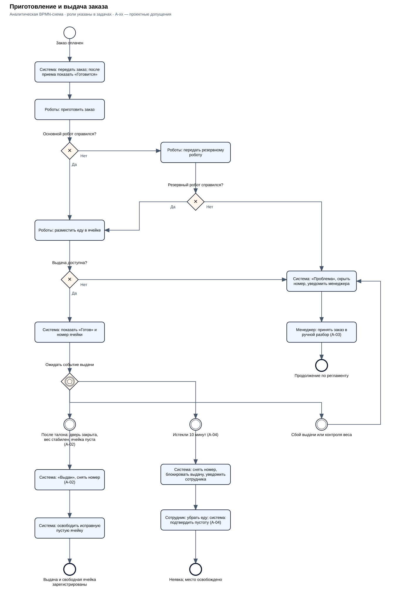
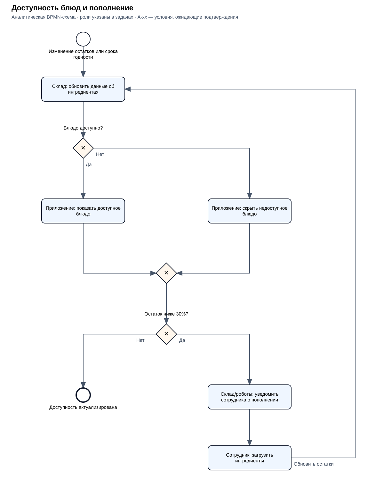

# Бизнес-процессы

Версия этапа 1. Продуктовые правила приняты для учебного проекта; ограничения и технические допущения A-xx описаны в [допущениях](../02_requirements/assumptions.md).

| Процесс | Ответственность приложения | Релиз |
|---|---|---|
| Оформление и оплата | Меню, корзина, тип обслуживания, расчет, карта и талон | MVP; лояльность/наличные — первый релиз |
| Приготовление и выдача | Передача оплаченного заказа, обработка состояний, табло, помощь при сбое | MVP |
| Доступность и пополнение | Скрытие недоступных блюд по данным склада; пополнение и заявки выполняются вне приложения | MVP — доступность; собственный монитор производства — первый релиз, A-05 |
| Управление меню | Позиции, цены, акции, комбо готовых блюд и техкарты | Первый релиз; первоначальная загрузка для MVP — A-01 |
| Помощь и возврат | MVP — минимальный экран и ручной возврат; первый релиз — полное рабочее место | Оба релиза в разном объеме, A-03 |
| Продажи и отчетность | Отчеты и передача в 1С | Первый релиз, A-13 |

## 1. Оформление и оплата

1. Гость начинает новую сессию. Киоск показывает актуальное меню без недоступных блюд.
2. Гость открывает карточки, добавляет блюда, меняет количество и проверяет корзину. Пустая корзина не допускается к оплате.
3. При наличии бургера предлагаются доступные картошка и пирожок. Они добавляются только по выбору гостя.
4. Применяется бизнес-ланч в будни с 10:00 до 16:00. По A-01 скидка составляет 10% на обычные блюда, кроме комбо и позиций с другой акционной ценой; сумма фиксируется на попытку оплаты.
5. Гость выбирает «В зале» или «С собой». Тип сохраняется и влияет на упаковку. Лояльность и наличные добавляются в первом релизе.
6. Перед оплатой система повторно проверяет доступность, рассчитывает итог и предлагает подтвердить его. Недоступная позиция не заменяется автоматически: гость удаляет ее либо выбирает замену, затем подтверждает новый итог. По A-08 перед оплатой атомарно резервируются ингредиенты. Возможность такого резерва является техническим допущением для проверки на этапе 2.
7. До обращения к эквайрингу сохраняются внутренний идентификатор покупки, сумма и идентификатор попытки оплаты. Начинается оплата картой. При подтвержденном успехе фиксируются оплаченный состав и сумма, выдается один номер и талон; заказ передается роботам. Неоплаченный заказ не готовится.
8. После оплаты внешний кассовый контур формирует чек, который выдается гостю отдельно от талона либо в составе одного печатного документа. Сбой чека/печати вызывает менеджера и сверку, не повторную оплату; незавершенная выдача чека сохраняется до разрешения (A-14).
9. При подтвержденном отказе гость получает сообщение, может вернуться к корзине или начать новую попытку с актуальной суммой. При неизвестном результате сначала выполняется сверка: новую попытку до выяснения результата начинать нельзя.

До запуска оплаты гость может прервать оформление; после 2 минут бездействия появляется предупреждение, еще через 2 минуты начинается новая сессия. Для начатого платежа правило автоматического сброса корзины не применяется. При неизвестном результате через 1 минуту вызывается менеджер; операция сохраняется и сверяется по исходному идентификатору. Оплата следующего гостя на этом терминале блокируется до безопасного завершения предыдущей операции (A-07).

При потере необходимой для продажи связи новые продажи приостанавливаются. Уже оплаченные заказы не удаляются. Возможность завершить их приготовление зависит от доступности роботов; если выполнить заказ нельзя, требуется менеджер. Новые продажи блокируются при невозможности проверить доступность, надежно зарегистрировать заказ, провести оплату, принять задание в производство либо обеспечить кассовый контур и выдачу документов (A-07, A-14).

### Исходная схема оформления

Исходная схема ДЗ 05 используется как источник процесса. В ней есть лояльность и подарок: по текущему разделению обе функции относятся к первому релизу. Схема еще не является отдельной актуальной схемой MVP; для текущего объема действуют шаги и разделение релизов выше. Окончательная переработка этой схемы зависит от правил скидки, оплаты и резерва.

## 2. Приготовление и выдача

[Открыть схему в полном размере](../assets/bpmn-fulfillment.svg).

[Редактируемая схема BPMN](../assets/bpmn-fulfillment.bpmn).

Схема аналитическая, неисполняемая: роли указаны в задачах, дорожки не выделены. Обмен конкретными запросами и событиями — этап 3. A-02/03/04 фиксируют выбранные правила учебного проекта и границы технических допущений.

| Шаг | Правило |
|---|---|
| Передача | После подтверждения оплаты задание передается роботам; после приема в работу на табло появляется «Готовится». Неизвестный результат передачи требует сверки, а не создания второго логического задания |
| Приготовление | При отказе основного робота задание передается резервному. Если переключение успешно, номер остается в «Готовится» |
| Доступность выдачи | «Готов» появляется только когда еда помещена в назначенную исправную ячейку и доступна гостю. Окончание приготовления само по себе недостаточно |
| Талон | Действительный талон открывает только назначенную ячейку. При неверном талоне ячейка не открывается, гость может повторить попытку либо обратиться к менеджеру |
| Условная выдача | Открытие ячейки своим талоном регистрирует условное «Выдан» и снимает номер (A-02), без контроля фактического извлечения |
| Незабранная еда | Через 10 минут от готовности и появления номера доступность выдачи прекращается, номер снимается, сотрудник уведомляется для удаления еды. Ячейка свободна после удаления, а не по таймеру (A-04) |
| Освобождение после открытия | После закрытия ячейки сотрудник зала проверяет ее, удаляет оставшуюся еду и подтверждает освобождение в минимальном экране. До этого ячейка недоступна следующему заказу |
| Результат неявки | Неявка отличается от зарегистрированной выдачи. Автоматический возврат или повторное приготовление только из-за неявки не выполняются |

Время хранения 10 минут принято автором как проектное допущение и требует подтверждения технолога. Открытие ячейки не доказывает ее пустоту: контроль/освобождение места описывается отдельно в A-02. Детекция фактического получения гостем в MVP не требуется.

### Проблема приготовления или выдачи

Если еда готова, но все ячейки заняты, заказ не объявляется «Готов»: устанавливается «Проблема» и вызывается менеджер для организации доступной выдачи.

При проблеме, требующей вмешательства, устанавливается внутренний статус «Проблема», номер убирается с табло. Менеджер немедленно уведомляется: номер заказа, этап, время и причина. На табло постоянно показана подсказка: **«Если ваш номер исчез до получения заказа, обратитесь к менеджеру».**

Менеджер приглашает гостя по номеру заказа в зале; гость также может обратиться сам по подсказке на табло. После устранения проблемы номер возвращается в «Готовится» либо «Готов» по фактическому состоянию. Срок хранения уже приготовленной порции при скрытии не начинается заново; просроченная еда не возвращается в готовую выдачу (A-04). Если исполнить заказ нельзя, менеджер организует возврат по ручному регламенту. Скрытие номера не отменяет заказ и не запускает возврат; данные сохраняются.

Ветвь диаграммы «Продолжение по регламенту» означает передачу в ручной порядок, а не автоматическое завершение или успешный возврат. Менеджер получает звуковое и визуальное уведомление в минимальном защищенном экране с данными заказа; принятие инцидента фиксируется. Целевое начало разбора — до 1 минуты (A-03/A-06).

## 3. Доступность блюд и пополнение

[Открыть схему в полном размере](../assets/bpmn-availability.svg).

[Редактируемая схема BPMN](../assets/bpmn-availability.bpmn).

1. Складская система обновляет остатки и сроки годности по данным производства или пополнения. Истечение срока годности также должно инициировать пересчет, а не ждать следующей продажи.
2. Приложение определяет доступность блюда по достаточности годных ингредиентов и скрывает недоступные позиции. После подтверждения достаточного запаса возвращает блюдо.
3. При снижении запаса в роботе ниже 30% складской/производственный контур уведомляет сотрудника.
4. Сотрудник загружает ингредиенты вручную; склад получает актуальные данные, доступность пересчитывается.

Это аналитическая схема процесса ресторана целиком. Приложение заказа отвечает за доступность меню; склад, роботы и сотрудник показаны как участники общего процесса, а не компоненты нашего приложения. Схема не подтверждает наличие встроенных средств мониторинга: наличие внешнего монитора принято как допущение A-05.

Плановые заявки с лагом в сутки и срочное пополнение в течение 5 часов принадлежат внешней складской системе и на данной схеме не детализируются. Резерв ингредиентов под неоплаченный заказ — правило A-08, принятое как техническое допущение о возможностях склада.

## 4. Управление меню и акции

В MVP выполняется первоначальная загрузка актуального меню, цен и правил бизнес-ланча до запуска ресторана (A-01). Наличие редактора в MVP не предполагается.

В первом релизе менеджер по ассортименту изменяет меню, цены, акции и комбо из готовых блюд; технолог — техкарты. Изменения вступают в силу со следующего торгового дня и не меняют оплаченные суммы прежних заказов. Конструктор состава блюда исключен.

Подарочный стакан относится к первому релизу (A-10). Сохраняются исходные условия: сумма более 1500 рублей с учетом скидки бизнес-ланча либо специальное комбо. Порог считается до списания бонусов; подарок предлагается и резервируется только при наличии. Правила бонусов и подарка заданы в A-10. В MVP подарок гостю не обещается.

## 5. Помощь, отмена и возврат

В MVP при невозможности приготовить или выдать оплаченный заказ менеджер получает сведения о проблеме, находит заказ по номеру и сверяет оплату. Если исполнение восстановлено, заказ продолжает путь с фактического состояния; иначе возврат оформляется через доступные платежные и кассовые средства. Результат сверяется с заказом. Отмена, ожидание возврата и подтвержденный возврат — разные события.

Минимальный просмотр заказа включен в MVP. Возможности внешних платежных и кассовых средств для ручного возврата приняты как техническое допущение, проверяемое на этапе 2 (A-03).

Поиск по номеру доступен уже в минимальном экране MVP. В первом релизе добавляются запуск отмены/возврата из полного интерфейса сотрудника и наличные. Допустимые причины и границы отмены заданы в A-12; частичные возвраты не входят в текущий объем.

## 6. Продажи и отчетность

Первый релиз: продажи и возвраты доступны в отчетах и передаются в 1С. Показатели и ежедневная выгрузка после закрытия торгового дня заданы в A-13. Повтор не удваивает продажи; сбой сохраняет данные для повторной отправки. Недоступность отчетности не удаляет и не меняет факт оплаченного заказа.

Источники процессов: ДЗ 05–07, протоколы ДЗ 04 и [проектные допущения](../02_requirements/assumptions.md). Формальные состояния и контракты обмена будут детализированы на этапах 2–3.
