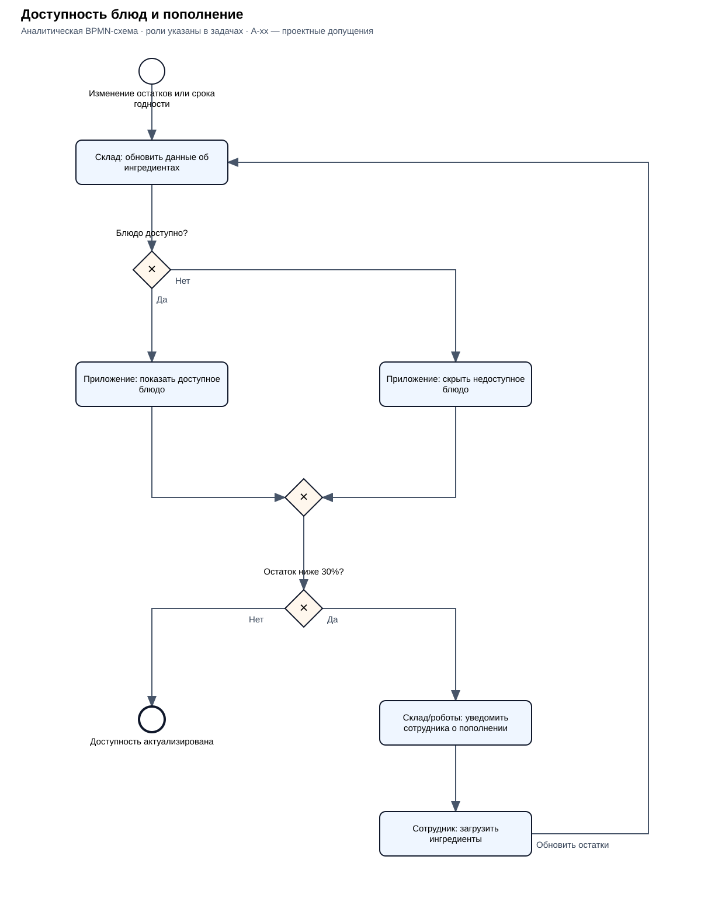

# Бизнес-процессы

Ниже описаны действия гостя, приложения, сотрудников и внешних систем. Дополнительные правила приведены в [допущениях](../02_requirements/assumptions.md).

| Процесс | Ответственность приложения | Релиз |
|---|---|---|
| Оформление и оплата | Меню, корзина, тип обслуживания, расчет, карта и талон | MVP; лояльность/наличные — первый релиз |
| Приготовление и выдача | Передача оплаченного заказа, обработка состояний, табло, помощь при сбое | MVP |
| Доступность и пополнение | Скрытие недоступных блюд по данным склада; пополнение и заявки выполняются вне приложения | MVP — доступность; собственный монитор производства — первый релиз, A-05 |
| Управление меню | Позиции, цены, акции, комбо готовых блюд и техкарты | Первый релиз; первоначальная загрузка для MVP — A-01 |
| Помощь и возврат | MVP — минимальный экран и ручной возврат; первый релиз — полное рабочее место | Оба релиза в разном объеме, A-03 |
| Продажи и отчетность | Отчеты и передача в 1С | Первый релиз, A-13 |

## 1. Оформление и оплата

1. Гость начинает новую сессию. Киоск показывает актуальное меню без недоступных блюд.
2. Гость открывает карточки, добавляет блюда, меняет количество и проверяет корзину. Пустую корзину оплатить нельзя.
3. При выборе бургера предлагаются доступные картошка и пирожок. Они добавляются только по выбору гостя.
4. В будни с 10:00 до 16:00 действует бизнес-ланч. Скидка составляет 10% на обычные блюда, кроме комбо и позиций с другой акционной ценой. Сумма фиксируется на одну попытку оплаты (A-01).
5. Гость выбирает «В зале» или «С собой». Выбор сохраняется и определяет упаковку. Лояльность и наличная оплата добавляются в первом релизе.
6. Перед оплатой система повторно проверяет доступность и рассчитывает итог. Если блюдо стало недоступно, гость удаляет его или выбирает замену и подтверждает новую сумму. Замена без согласия гостя не выполняется. До оплаты склад резервирует весь состав заказа. Атомарный резерв — [допущение A-08](../04_architecture/integrations.md).
7. Перед вызовом банка склад должен подтвердить удержание всего резерва за исходной попыткой. При потере ответа приложение сверяет ту же операцию. Если срок истек раньше удержания, требуется новый резерв и согласие гостя. До обращения к банку сохраняются состав и количество блюд, тип обслуживания, расчет скидок, итоговая сумма, идентификаторы покупки и попытки оплаты, связь с резервом. После подтверждения сохраняется результат оплаты, гостю выдается один номер и талон, заказ передается роботам. После сбоя платеж сверяется с сохраненной покупкой. Неоплаченный заказ не готовится. Перед отправкой подтверждается пригодность резерва по НФТ-02. При неизвестной пригодности отправка блокируется до сверки; невозможность выполнения ведет к проблеме и полному возврату.
8. Внешняя кассовая система формирует чек. Он выдается отдельно от талона или на одном листе с ним. При сбое формирования или печати система сохраняет задачу выдачи чека, уведомляет менеджера и проверяет результат операции. Повторная оплата не запускается. При сбое талона киоск показывает номер заказа и вызывает менеджера. Менеджер проверяет покупку и повторно печатает талон того же заказа по [A-14](../02_requirements/assumptions.md#ticket-recovery).
9. При подтвержденном отказе банка гость видит сообщение и может вернуться к корзине или повторить оплату с актуальной суммой. Если результат неизвестен, сначала проверяется предыдущая попытка.

До начала оплаты гость может прервать оформление. После 2 минут бездействия появляется предупреждение, еще через 2 минуты начинается новая сессия.

Для начатого платежа автоматический сброс не действует. Если результат неизвестен 1 минуту, вызывается менеджер. Операция сохраняется и проверяется по исходному идентификатору. Киоск не принимает оплату следующего гостя до безопасного завершения предыдущей операции (A-07).

При потере необходимой связи новые продажи останавливаются. Уже оплаченные заказы сохраняются и готовятся, если роботы доступны. Если выполнить заказ нельзя, подключается менеджер.

Для новой продажи должны работать проверка наличия блюд, сохранение заказа, оплата, прием задания кухней, кассовая система и выдача документов (A-07, A-14).

### Плановый перерыв и закрытие {#planned-stop}

Регулярные технические работы проводятся вне часов работы 10:00–22:00 (A-16). Остановки продаж внутри дня допускаются по A-15 и учитываются вместе со сбоями в общем бюджете простоя по НФТ-04.

По A-15 менеджер останавливает новые продажи в минимальном экране перед перерывом или закрытием. Киоски показывают сообщение об остановке. Новые сессии и запуск оплаты запрещены. Открытые корзины без начатого платежа сбрасываются после сообщения гостю, их резервы освобождаются.

Начатая оплата не отменяется остановкой продаж. При подтвержденном отказе резерв освобождается, новая попытка до возобновления продаж недоступна. Неизвестный результат сверяется по A-07/A-08. Подтвержденная оплата приводит к выполнению сохраненного заказа.

Кухня, табло и выдача продолжают обслуживать оплаченные заказы. Оборудование не отключается, пока начатые платежи не сверены, а оплаченные заказы не выданы, не завершены по неявке или не отменены с оформлением возврата. Неподтвержденные возвраты остаются на контроле менеджера.

Допущение для пилота: C-08 ведет торговый день по локальному режиму A-16. В 10:00 он регистрирует открытие дня и версию меню, в 22:00 — закрытие. Повтор события для того же ресторана и даты сохраняет исходный ID. После перезапуска C-08 сверяет последнее сохраненное событие с локальной датой и часами до допуска новых продаж. Открытие дня сохраняет ручную остановку до команды менеджера. Перерыв внутри дня не закрывает день.

Закрытие торгового дня не меняет состав, суммы и связи прежних заказов. Незавершенные операции остаются связанными с исходным торговым днем. Изменения меню нового дня к ним не применяются.

Менеджер возобновляет продажи после окончания перерыва или открытия нового торгового дня и успешной проверки доступности блюд, сохранения заказа, оплаты, приема задания кухней, кассовой системы и печати. Плановая остановка в часы работы ресторана учитывается как простой по НФТ-04.

## 2. Приготовление и выдача

[Открыть схему в полном размере](../assets/bpmn-fulfillment.svg).

[Редактируемая схема BPMN](../assets/bpmn-fulfillment.bpmn).

Схема показывает основные действия; участники указаны в задачах. Попытка размещения включает проверку свободной исправной ячейки. Если ячейки нет или размещение не подтверждено, выполняется ветка «Нет». Правила выдачи и исключения — A-02/A-03/A-04.

На схеме выдача завершается после открытия действительным талоном, закрытия дверцы и подтверждения пустоты исправным датчиком веса. Если гость забрал только часть заказа, ожидание продолжается, срок хранения не начинается заново.

| Шаг | Правило |
|---|---|
| Передача | После подтверждения оплаты задание передается роботам. Когда оно принято в работу, на табло появляется «Готовится». Если результат передачи неизвестен, система проверяет исходное задание, не создавая новое |
| Приготовление | При отказе основного робота задание передается резервному. Если переключение успешно, номер остается в «Готовится» |
| Доступность выдачи | Перед размещением проверяется наличие исправной свободной ячейки. Если ее нет, фиксируется «Проблема». После размещения порции и подтверждения веса в исправной ячейке табло показывает «Готов». Открыть ячейку талоном можно после подтверждения показа и применения комплексом исходного срока доступа |
| Талон | Действительный талон открывает только назначенную ячейку. При неверном талоне дверца остается закрытой. Гость может повторить попытку или обратиться к менеджеру |
| Подтвержденная выдача | После открытия своим талоном и закрытия дверцы исправный датчик должен показать стабильный вес пустой ячейки. Тогда устанавливается «Выдан» и номер снимается с табло (A-02) |
| Гость не забрал заказ | Через 10 минут после появления номера в «Готов» выдача блокируется, номер снимается, сотрудник получает уведомление и убирает еду. Ячейка освобождается после закрытия дверцы и подтверждения пустоты исправным датчиком (A-04) |
| Освобождение | Исправная ячейка освобождается автоматически после закрытия дверцы и подтверждения пустоты по весу. Если еда осталась, ячейка занята. Гость может забрать остаток тем же талоном до окончания срока хранения |
| Результат неявки | Если выполнены условия доступности для неявки и гость не забрал заказ полностью, заказ завершается по неявке. Автоматический возврат и повторное приготовление из-за неявки не выполняются |

При истечении срока система сверяет выдачу талона, сообщения табло и события ячейки. Первичное включение доступа оценивается по допущению пилота из модели. Неустраненный сбой печати или позднее включение доступа ведут к разбору по [правилам выдачи](../03_model/order-states.md#pickup-window).

Срок хранения 10 минут принят как допущение. Перед реальным запуском его проверяет технолог. Датчик веса проверяет пустоту, но не состав пакета и чистоту поверхности. Очистка выполняется по отдельному регламенту. При сбое измерения ячейка блокируется для новых заказов и вызывается менеджер.

### Проблема приготовления или выдачи

Если еда готова, но свободных ячеек нет, устанавливается «Проблема» и вызывается менеджер. Статус «Готов» до организации выдачи не показывается.

При проблеме, требующей вмешательства, номер скрывается с табло. Менеджер сразу получает номер заказа, этап, время и причину сбоя. На табло постоянно видна подсказка: **«Если ваш номер исчез до получения заказа, обратитесь к менеджеру».**

Менеджер приглашает гостя по номеру заказа в зале. Гость также может обратиться сам. После решения проблемы номер возвращается в «Готовится» или «Готов» по состоянию заказа. Скрытие номера не начинает срок хранения заново. При неизвестном результате система блокирует доступ в исходный срок и сверяет события назначения. Выдача, состоявшаяся до срока, сохраняется. Если после сверки полное получение исключено, а требуемое окно выдачи нарушено или его невозможно подтвердить, менеджер отменяет заказ и оформляет полный возврат по A-12. Еда с истекшим сроком не возвращается в готовую выдачу (A-04).

Если заказ нельзя выполнить, менеджер оформляет возврат по принятому регламенту. Само скрытие номера не отменяет заказ и не возвращает деньги. Данные заказа сохраняются.

На ветке «Продолжение по регламенту» менеджер принимает проблему по A-03 в течение 1 минуты после доставки уведомления. Исход заказа и возврата фиксируется отдельно.

## 3. Доступность блюд и пополнение

[Открыть схему в полном размере](../assets/bpmn-availability.svg).

[Редактируемая схема BPMN](../assets/bpmn-availability.bpmn).

1. Складская система обновляет остатки и сроки годности по данным производства или пополнения. Истечение срока годности также должно инициировать пересчет, а не ждать следующей продажи.
2. Приложение определяет доступность блюда по достаточности годных ингредиентов и скрывает недоступные позиции. После пополнения годного запаса блюдо возвращается в меню.
3. При снижении запаса в роботе ниже 30% складской/производственный контур уведомляет сотрудника.
4. Сотрудник загружает ингредиенты вручную; склад получает актуальные данные, доступность пересчитывается.

Схема охватывает общий процесс ресторана. Приложение отвечает за доступность блюд в меню. Склад, роботы и сотрудник участвуют в процессе как внешние по отношению к приложению участники. Наличие технического монитора роботов принято как допущение A-05.

Плановые заявки за сутки и срочное пополнение в течение 5 часов выполняются внешней складской системой. Подробности не входят в эту схему. Резерв ингредиентов перед оплатой описан в A-08; возможность такого резерва — допущение.

## 4. Управление меню и акции

До запуска MVP загружаются меню, цены и правила бизнес-ланча (A-01). Редактор добавляется в первом релизе.

В первом релизе менеджер по ассортименту изменяет меню, цены, акции и комбо из готовых блюд; технолог — техкарты. Изменения вступают в силу со следующего торгового дня и не меняют оплаченные суммы прежних заказов. Конструктор состава блюда исключен.

В первом релизе доступный стакан резервируется с заказом, если сумма после скидок до списания бонусов превышает 1500 ₽ либо выбрано специальное комбо (A-10). После оплаты комплекс получает стакан в составе задания и подтверждает комплектацию.

## 5. Помощь, отмена и возврат

В MVP менеджер находит заказ по ресторану, торговому дню и номеру. Без талона он открывает покупку из проблемы и проверяет ее по A-14. После устранения проблемы выполнение продолжается. При невозможности выполнения менеджер организует полный внешний возврат по A-03 и сверяет его по ID. Состояния заказа, денег и чека учитываются отдельно. В первом релизе менеджер запускает отмену и возврат из рабочего места по A-12. Частичный возврат исключен.

## 6. Продажи и отчетность

В первом релизе продажи и возвраты показываются в отчетах и выгружаются в 1С после закрытия торгового дня (A-13). При сбое данные сохраняются для повторной отправки. Поздно подтвержденная продажа относится к исходному дню. Аналитик передает ее дополнительным пакетом. Повтор пакета не удваивает операции. Недоступность отчетов не меняет оплаченные заказы.

Источники процессов: кейс ресторана, протоколы интервью и [проектные допущения](../02_requirements/assumptions.md). Переходы определены в [модели состояний](../03_model/order-states.md), порядок обмена — в [схемах интеграций](../04_architecture/integration-flows.md).
