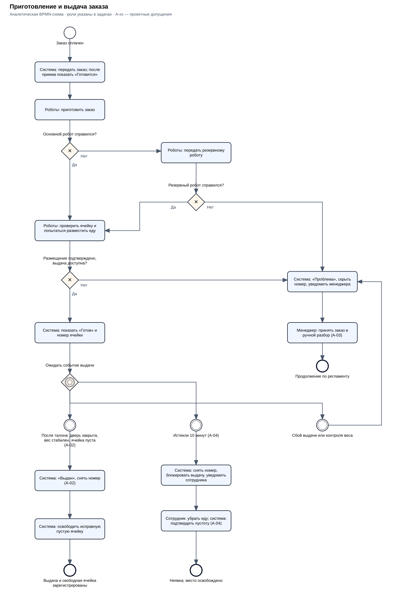

# Бизнес-процессы

Ниже описаны действия гостя, приложения, сотрудников и внешних систем. Дополнительные правила приведены в [допущениях](../02_requirements/assumptions.md).

| Процесс | Ответственность приложения | Релиз |
|---|---|---|
| Оформление и оплата | Меню, корзина, тип обслуживания, расчет, карта и талон | MVP; лояльность/наличные — первый релиз |
| Приготовление и выдача | Передача оплаченного заказа, обработка состояний, табло, помощь при сбое | MVP |
| Доступность и пополнение | Скрытие недоступных блюд по данным склада; пополнение и заявки выполняются вне приложения | MVP — доступность; собственный монитор производства — первый релиз, A-05 |
| Управление меню | Позиции, цены, акции, комбо готовых блюд и техкарты | Первый релиз; первоначальная загрузка для MVP — A-01 |
| Помощь и возврат | MVP — минимальный экран и ручной возврат; первый релиз — полное рабочее место | Оба релиза в разном объеме, A-03 |
| Продажи и отчетность | Отчеты и передача в 1С | Первый релиз, A-13 |

## 1. Оформление и оплата

1. Гость начинает новую сессию. Киоск показывает актуальное меню без недоступных блюд.
2. Гость открывает карточки, добавляет блюда, меняет количество и проверяет корзину. Пустую корзину оплатить нельзя.
3. При выборе бургера предлагаются доступные картошка и пирожок. Они добавляются только по выбору гостя.
4. В будни с 10:00 до 16:00 действует бизнес-ланч. Скидка составляет 10% на обычные блюда, кроме комбо и позиций с другой акционной ценой. Сумма фиксируется на одну попытку оплаты (A-01).
5. Гость выбирает «В зале» или «С собой». Выбор сохраняется и определяет упаковку. Лояльность и наличная оплата добавляются в первом релизе.
6. Перед оплатой система повторно проверяет доступность и рассчитывает итог. Если блюдо стало недоступно, гость удаляет его или выбирает замену и подтверждает новую сумму. Замена без согласия гостя не выполняется. Ингредиенты резервируются за заказом по A-08. Возможность такого резерва проверяется на этапе 2.
7. До обращения к банку сохраняются идентификаторы покупки и попытки оплаты, а также сумма. После подтверждения оплаты сохраняются состав и оплаченная сумма, гостю выдается один номер и талон, заказ передается роботам. Неоплаченный заказ не готовится.
8. Внешняя кассовая система формирует чек. Он выдается отдельно от талона или на одном листе с ним. При сбое формирования или печати система сохраняет задачу выдачи чека, уведомляет менеджера и проверяет результат операции. Повторная оплата не запускается (A-14).
9. При подтвержденном отказе банка гость видит сообщение и может вернуться к корзине или повторить оплату с актуальной суммой. Если результат неизвестен, сначала проверяется предыдущая попытка.

До начала оплаты гость может прервать оформление. После 2 минут бездействия появляется предупреждение, еще через 2 минуты начинается новая сессия.

Для начатого платежа автоматический сброс не действует. Если результат неизвестен 1 минуту, вызывается менеджер. Операция сохраняется и проверяется по исходному идентификатору. Киоск не принимает оплату следующего гостя до безопасного завершения предыдущей операции (A-07).

При потере необходимой связи новые продажи останавливаются. Уже оплаченные заказы сохраняются и готовятся, если роботы доступны. Если выполнить заказ нельзя, подключается менеджер.

Для новой продажи должны работать проверка наличия блюд, сохранение заказа, оплата, прием задания кухней, кассовая система и выдача документов (A-07, A-14).

## 2. Приготовление и выдача

[Открыть схему в полном размере](../assets/bpmn-fulfillment.svg).

[Редактируемая схема BPMN](../assets/bpmn-fulfillment.bpmn).

Схема показывает основные действия; участники указаны в задачах. Подробный обмен запросами и событиями описывается на этапе 3. Правила выдачи и исключения заданы в A-02/A-03/A-04.

На схеме выдача завершается после открытия действительным талоном, закрытия дверцы и подтверждения пустоты исправным датчиком веса. Если гость забрал только часть заказа, ожидание продолжается, срок хранения не начинается заново.

| Шаг | Правило |
|---|---|
| Передача | После подтверждения оплаты задание передается роботам. Когда оно принято в работу, на табло появляется «Готовится». Если результат передачи неизвестен, система проверяет исходное задание, не создавая новое |
| Приготовление | При отказе основного робота задание передается резервному. Если переключение успешно, номер остается в «Готовится» |
| Доступность выдачи | «Готов» появляется после размещения еды в исправной ячейке, подтверждения веса и доступности получения. До этого завершенное приготовление не означает готовность к выдаче |
| Талон | Действительный талон открывает только назначенную ячейку. При неверном талоне дверца остается закрытой. Гость может повторить попытку или обратиться к менеджеру |
| Подтвержденная выдача | После открытия своим талоном и закрытия дверцы исправный датчик должен показать стабильный вес пустой ячейки. Тогда устанавливается «Выдан» и номер снимается с табло (A-02) |
| Незабранная еда | Через 10 минут после появления номера в «Готов» выдача блокируется, номер снимается, сотрудник получает уведомление и убирает еду. Ячейка освобождается после закрытия дверцы и подтверждения пустоты исправным датчиком (A-04) |
| Освобождение | Исправная ячейка освобождается автоматически после закрытия дверцы и подтверждения пустоты по весу. Если еда осталась, ячейка занята. Гость может забрать остаток тем же талоном до окончания срока хранения |
| Результат неявки | Незабранный заказ завершается по неявке. Автоматический возврат и повторное приготовление из-за неявки не выполняются |

Срок хранения 10 минут принят как допущение. Перед реальным запуском его проверяет технолог. Датчик веса проверяет пустоту, но не состав пакета и чистоту поверхности. Очистка выполняется по отдельному регламенту. При сбое измерения ячейка блокируется для новых заказов и вызывается менеджер.

### Проблема приготовления или выдачи

Если еда готова, но свободных ячеек нет, устанавливается «Проблема» и вызывается менеджер. Статус «Готов» до организации выдачи не показывается.

При проблеме, требующей вмешательства, номер скрывается с табло. Менеджер сразу получает номер заказа, этап, время и причину сбоя. На табло постоянно видна подсказка: **«Если ваш номер исчез до получения заказа, обратитесь к менеджеру».**

Менеджер приглашает гостя по номеру заказа в зале. Гость также может обратиться сам. После решения проблемы номер возвращается в «Готовится» или «Готов» по состоянию заказа. Скрытие номера не начинает срок хранения заново. Еда с истекшим сроком не возвращается в готовую выдачу (A-04).

Если заказ нельзя выполнить, менеджер оформляет возврат по принятому регламенту. Само скрытие номера не отменяет заказ и не возвращает деньги. Данные заказа сохраняются.

Ветка схемы «Продолжение по регламенту» означает передачу проблемы менеджеру. Она не означает, что заказ уже завершен или возврат выполнен. На минимальном экране менеджера проблема выделяется звуком и визуально; ее принятие фиксируется. Разбор должен начаться в течение 1 минуты (A-03/A-06).

## 3. Доступность блюд и пополнение

[Открыть схему в полном размере](../assets/bpmn-availability.svg).

[Редактируемая схема BPMN](../assets/bpmn-availability.bpmn).

1. Складская система обновляет остатки и сроки годности по данным производства или пополнения. Истечение срока годности также должно инициировать пересчет, а не ждать следующей продажи.
2. Приложение определяет доступность блюда по достаточности годных ингредиентов и скрывает недоступные позиции. После пополнения годного запаса блюдо возвращается в меню.
3. При снижении запаса в роботе ниже 30% складской/производственный контур уведомляет сотрудника.
4. Сотрудник загружает ингредиенты вручную; склад получает актуальные данные, доступность пересчитывается.

Схема охватывает общий процесс ресторана. Приложение отвечает за доступность блюд в меню. Склад, роботы и сотрудник участвуют в процессе как внешние по отношению к приложению участники. Наличие технического монитора роботов принято как допущение A-05.

Плановые заявки за сутки и срочное пополнение в течение 5 часов выполняются внешней складской системой. Подробности не входят в эту схему. Резерв ингредиентов перед оплатой описан в A-08; возможность такого резерва — допущение.

## 4. Управление меню и акции

До запуска MVP загружаются меню, цены и правила бизнес-ланча (A-01). Редактор добавляется в первом релизе.

В первом релизе менеджер по ассортименту изменяет меню, цены, акции и комбо из готовых блюд; технолог — техкарты. Изменения вступают в силу со следующего торгового дня и не меняют оплаченные суммы прежних заказов. Конструктор состава блюда исключен.

Подарочный стакан относится к первому релизу (A-10). Он выдается при сумме более 1500 рублей после скидки бизнес-ланча, до списания бонусов, либо при специальном комбо. Стакан предлагается и резервируется только при наличии (A-10). В MVP подарок не предлагается.

## 5. Помощь, отмена и возврат

В MVP менеджер получает сообщение о проблеме, находит заказ по номеру и проверяет оплату. Если проблему удалось устранить, выполнение заказа продолжается. Если нет — возврат проводится через платежную и кассовую системы, а результат связывается с заказом. Отмена заказа, ожидание возврата и подтвержденный возврат учитываются отдельно.

Просмотр заказа доступен в минимальном экране MVP. Возможность оформить возврат через внешние системы принята как допущение и проверяется на этапе 2 (A-03).

Поиск по номеру доступен уже в минимальном экране MVP. В первом релизе добавляются запуск отмены/возврата из полного интерфейса сотрудника и наличные. Допустимые причины и границы отмены заданы в A-12; частичные возвраты не входят в текущий объем.

## 6. Продажи и отчетность

В первом релизе продажи и возвраты показываются в отчетах и выгружаются в 1С после закрытия торгового дня (A-13). При сбое данные сохраняются для повторной отправки. Повторная выгрузка не удваивает продажи. Недоступность отчетов не меняет оплаченные заказы.

Источники процессов: ДЗ 05–07, протоколы ДЗ 04 и [проектные допущения](../02_requirements/assumptions.md). Подробная модель состояний и описание обмена данными разрабатываются на этапах 2–3.
