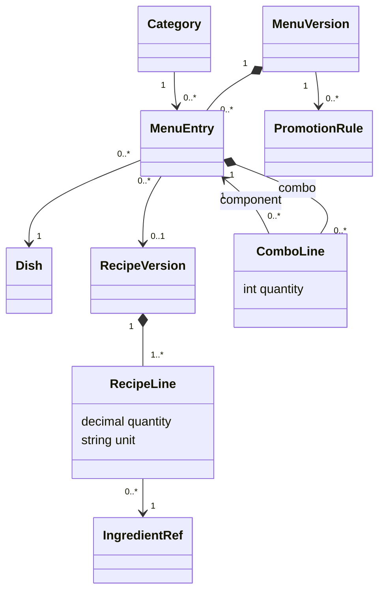
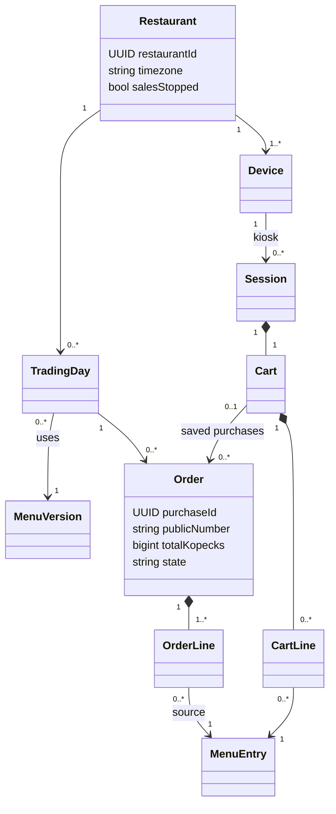
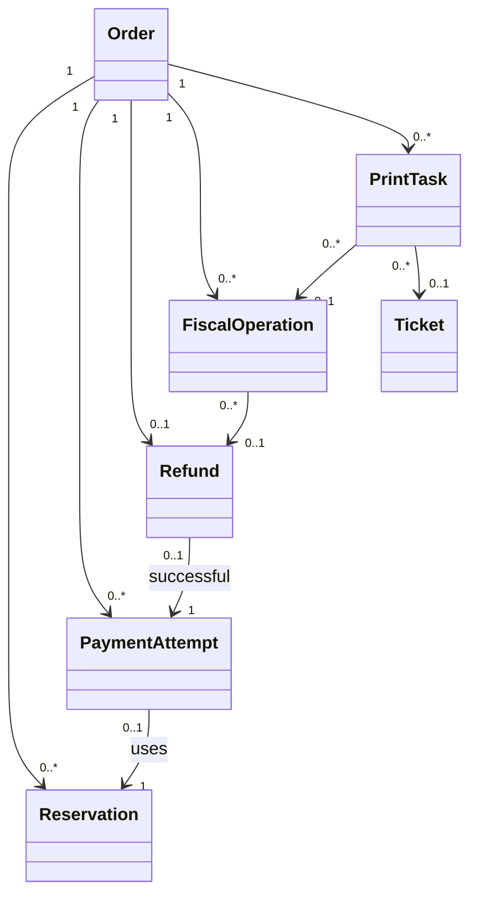
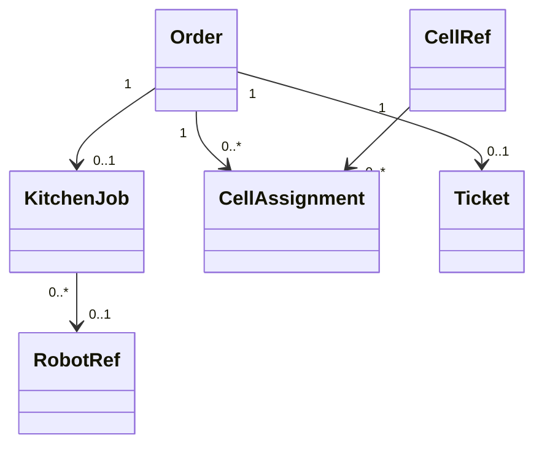
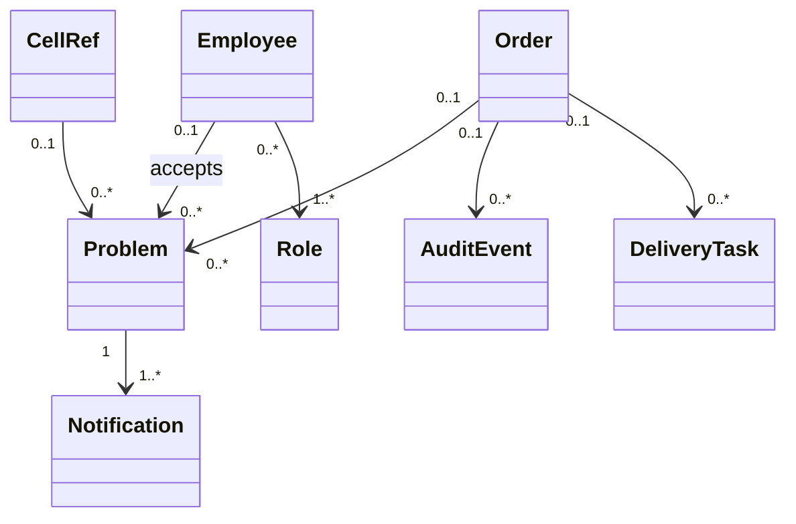
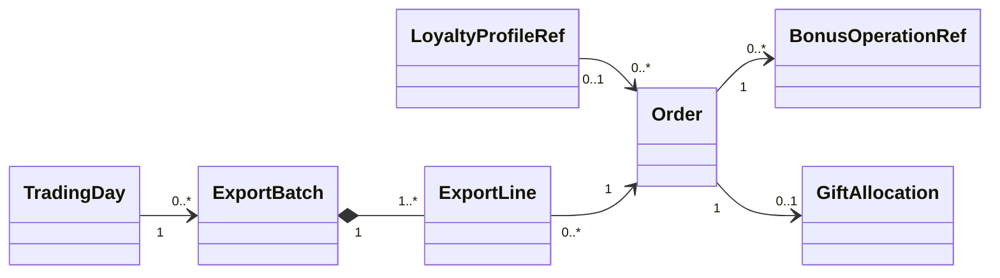

# Диаграмма классов

Модель охватывает MVP и первый релиз. Склад, роботы, эквайринг и касса остаются внешними системами. Приложение хранит необходимые ссылки и результаты их операций. Диаграммы разделены по областям; одинаковое имя обозначает одну сущность. Атрибуты и ограничения раскрыты в [словаре](entities.md), переходы — в [модели состояний](order-states.md).

## Каталог

[Открыть схему в полном размере](../assets/stage2-class-diagram-1.svg).

## Ресторан и покупка

[Открыть схему в полном размере](../assets/stage2-class-diagram-2.svg).

`Device` различает киоск, табло и терминал сотрудника. Ячейка имеет отдельный жизненный цикл. Заказ не наследуется от корзины. После сохранения снимка изменение состава создает новую покупку; это разрешено только после безопасного завершения предыдущей оплаты. Повтор оплаты неизмененной покупки после отказа использует тот же purchaseId и новую попытку.

Комбо состоит из готовых блюд, ссылки на себя и циклы запрещены. У обычной позиции нет ComboLine. В MVP меню и правила загружаются до запуска; редакторы US-27–30 относятся к первому релизу. Одна версия меню может использоваться несколькими торговыми днями.

## Оплата и документы

[Открыть схему в полном размере](../assets/stage2-class-diagram-3.svg).

## Кухня и ячейка

[Открыть схему в полном размере](../assets/stage2-class-diagram-4.svg).

## Помощь и служебные данные

[Открыть схему в полном размере](../assets/stage2-class-diagram-5.svg).

RobotRef и CellRef — ссылки на оборудование внешнего комплекса. История назначений ячейки сохраняется, одновременно активно только одно. Резерв создается до попытки и может остаться без нее. Каждая попытка использует один отдельный резерв; после отказа он освобождается, перед новой попыткой создается новый. Успешное списание по покупке не более одного. Возврат полный, повторные обращения относятся к одной операции.

## Первый релиз

[Открыть схему в полном размере](../assets/stage2-class-diagram-6.svg).

Баланс принадлежит внешней системе лояльности. Наличная оплата использует PaymentAttempt, возврат — Refund. Правила бонусов определяются A-10. Конструктор комбобургера исключен.

Основание: БТ-01–18, US-01–35, A-01–16.
