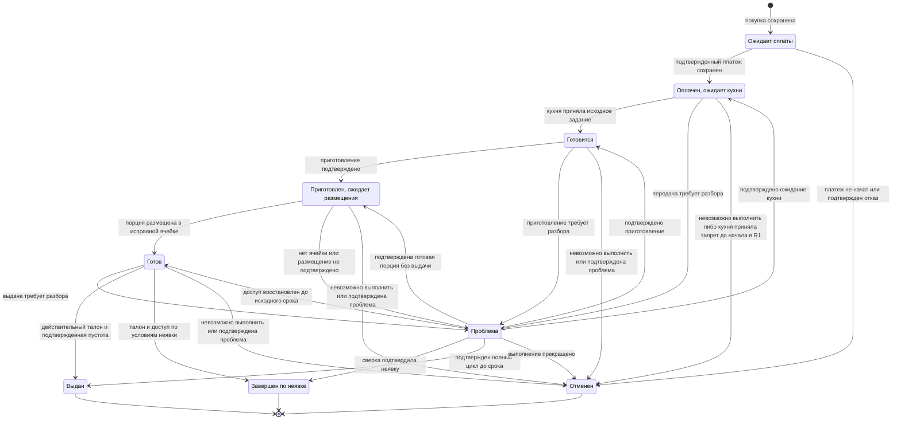

# Состояния заказа и переходы

Состояния заказа, платежа, возврата и ячейки учитываются отдельно. Табло показывает только «Готовится» и «Готов». Отправка задания еще не означает его принятие; окончание приготовления еще не означает возможность получения.

## Заказ

[Открыть схему в полном размере](../assets/stage2-order-states-1.svg).

| Переход | Инициатор и обязательное условие | Результат |
|---|---|---|
| Создание → Ожидает оплаты | Оформление: состав непустой, снимок и резерв сохранены | Есть purchaseId; публичного номера и задания кухни еще нет |
| Ожидает оплаты → Оплачен | Адаптер эквайринга: успех исходной попытки, совпадают сумма и валюта | Одна транзакция сохраняет успех, номер, задание кухни, задачи чека и талона. Отправка задания разрешается только после подтверждения пригодности резерва по НФТ-02; неизвестная пригодность требует сверки, невозможность выполнения — проблемы и полного возврата |
| Оплачен → Готовится | Комплекс подтвердил принятие jobId | Номер появляется на табло; фиксируется время принятия |
| Готовится → Ожидает размещения | Комплекс подтвердил завершение приготовления | На табло остается «Готовится», до подтверждения размещения и исправного контроля веса |
| Ожидает размещения → Готов | Комплекс подтвердил размещение, рост веса и исправную ячейку | Табло подтверждает первый показ версии проекции; сохраняются firstReadyAt и expiresAt. Комплекс подтверждает применение срока, затем разрешает получение. Неизвестный результат сверяется; невозможность организовать доступную выдачу ведет к проблеме |
| Рабочее состояние → Проблема | Обработчик выявил сбой, требующий сотрудника | Номер скрыт, этап сохранен, менеджер уведомлен |
| Проблема → Рабочее состояние | Менеджер завершил разбор; фактическое состояние подтверждено внешней системой | Произвольная установка «Готов» сотрудником запрещена; исходный срок сохраняется |
| Готов/Проблема → Выдан | Подтверждены размещение, открытие своим талоном, закрытие, исправное стабильное измерение пустоты | Талон недействителен, номер снят, ячейка освобождена |
| Готов/Проблема → Неявка | Срок истек. Подтверждены действующий талон у гостя и возможность получить заказ по условиям доступности ниже. Заказ остался в ячейке полностью или частично. При сбое сначала сверяются события комплекса | Доступ заблокирован, номер снят, сотрудник убирает остаток. Возврат и новое приготовление автоматически не запускаются |
| Неоплаченный → Отменен | Нет начатой/неизвестной оплаты либо подтвержден ее отказ | Резерв освобожден. Сброс сессии не подменяет сверку платежа |
| Оплаченный → Отменен | В MVP менеджер фиксирует невозможность выполнения и организует внешний возврат | Блокируются новые задания/выдача; начатую безопасную операцию завершает комплекс. Возврат контролируется отдельно |

**Доступность для гостя.** Для автоматической неявки гость должен иметь действующий талон к первому показу. Номер должен быть виден, а выдача — исправна до исходного expiresAt. Допущение пилота: на первичное включение доступа после показа допускается до 1 с включительно. Таким образом, из исходных 10 минут гостю доступны не менее 9 мин 59 с подряд. Допуск относится только к первичному включению. Любое последующее прерывание требует разбора. Перед пилотом условие проверяют на оборудовании и согласуют с рестораном. C-05 сопоставляет время выдачи талона, историю показа и фактические интервалы доступа по assignmentId. При сбое печати учитывается время передачи копии гостю, которое менеджер фиксирует при разрешении проблемы на S-02. Само принятие проблемы или отправка копии на принтер выдачу талона не подтверждают.

Если это условие нарушено, в том числе после частичного получения, автоматическая неявка запрещена. Сначала сверяются исходные события. Полное получение до срока дает «Выдан». Срок не продлевается. Если полная выдача исключена и сверка показала нарушение окна либо доказательства окна утрачены, менеджер фиксирует невозможность исполнения, отменяет заказ и оформляет полный возврат по A-12. Деньги и чек возврата сверяются отдельно. Пока неизвестен сам исход получения, заказ остается на разборе.

Для каждого назначения C-05 сверяет три источника.

- Талон. C-06 связывает исходную задачу печати с покупкой и временем физической выдачи бумаги в доступный гостю лоток его киоска. Если по журналу нельзя связать выдачу бумаги с сессией этого гостя, своевременная выдача остается неподтвержденной. Для копии используется время вручения, зарегистрированное менеджером на S-02 по исходной покупке и задаче копии.
- Табло. B-01 сохраняет подтвержденные интервалы фактического показа номера и ячейки. От первого показа до срока в каждый момент назначение должно быть видно хотя бы на одном исправном табло ресторана. Скрытие, устаревание и перезапуск завершают подтвержденный интервал. Потерянный журнал оставляет пробел.
- Ячейка. I-03 возвращает фактические интервалы исправного доступа по талону, события открытия, закрытия и контроля веса до срока. Сверяется полная последовательность до блокировки. Штатный цикл получения гостем учитывается как доступ. Время отправки команды и время доставки ответа не заменяют момент включения.

C-05 использует проверенную для времени события погрешность часов киоска, рабочего места менеджера, табло и комплекса. Если первый показ и начало подтвержденного интервала относятся к одному событию на табло, используется одна и та же отметка времени. При смене табло интервалы должны гарантированно перекрываться или стыковаться. Верхняя граница задержки равна самому позднему возможному включению минус самый ранний возможный первый показ. Она должна быть не больше 1 с. Вручение к первому показу и непрерывность интервалов также должны подтверждаться с учетом погрешности. Если граница неизвестна или интервал оценки пересекает порог, автоматическая неявка исключена.

В первом релизе US-24/25 добавляют запуск отмены и возврата из интерфейса. Для просьбы гостя переход в «Отменен» разрешен только после stopped_before_start от комплекса по исходному jobId. При already_started заказ продолжает выполняться. При неизвестном результате запрос остается на сверке без обязательства возврата. До приготовления допустима просьба гостя; после начала — только невозможность выполнения или подтвержденная проблема (A-12). В MVP произвольная отмена по просьбе гостя не добавляется.

Успешное переключение на резервного робота не меняет «Готовится» и jobId. Внутренний этап ожидания размещения не добавляет третью колонку табло. Если свободной ячейки нет, устанавливается «Проблема», согласно [процессу приготовления и выдачи](../01_business/processes.md#2).

## Платеж, резерв и возврат

Попытка оплаты: `Создана → Не запущена (склад подтвердил истечение до удержания) либо Создана → Выполняется → Успех / Отказ / Результат неизвестен`. Из неизвестного результата допустим только подтвержденный успех либо отказ/отмена внешней операции. Тайм-аут, остановка продаж и сброс киоска не являются отказом.

До вызова банка сохраняются попытка, сумма, снимок и связь с резервом. Склад атомарно удерживает действующий резерв для attemptId. Только подтвержденное удержание разрешает вызов банка. Если склад первым зарегистрировал истечение срока, попытка завершается до обращения в банк. Если сбой произошел до сохранения ответа, проверяется исходный attemptId. Сверка выполняется каждые 10 с; через 1 мин без результата вызывается менеджер. Проверка не прекращается по числу попыток. Следующая оплата на терминале запрещена до его безопасного освобождения.

Резерв: `Создается → Действует → Удержан для попытки → Закреплен за оплаченным заказом → Использован`, либо `Действует → Освобожден/Истек`. До платежа срок 5 мин. При неизвестном платеже резерв удерживается до сверки. При неизвестном результате создания сначала запрашивается тот же резерв, а не создается независимый дубль. Истекший резерв пересоздается до оплаты. Резерв не продлевает годность: перед передачей поздно оплаченного заказа проверяется пригодность; невозможность выполнения ведет к проблеме и полному возврату.

Возврат: `Требуется → Выполняется → Подтвержден`, с промежуточными `Результат неизвестен` и `Отказ`. Неизвестный результат сверяется по исходной операции; отказ допускает исправление причины и повтор той же логической операции. Подтвержденный возврат конечный. Внешнее подтверждение денег и кассовый документ возврата учитываются отдельно. Заказ может быть отменен, пока возврат еще неизвестен. Возврат по подтвержденной проблеме уже выданного заказа не меняет факт его выдачи. Полная сумма повторно не возвращается.

## Ячейка и талон

Ячейка: `Свободна → Назначена → Загрузка → Занята → Открыта гостем → Контроль после закрытия`. После стабильной пустоты она становится свободной; при остатке возвращается в «Занята». Из любого состояния возможна блокировка из-за неисправности или неизвестного контроля. После неявки: `Занята → Ожидает уборки → Обслуживание → Контроль → Свободна`.

Условия свободной ячейки: дверца закрыта, датчик исправен, пустота стабильна, прежнее назначение закончено, обслуживание завершено. После неявки очистка подтверждается сотрудником. Неисправную ячейку нельзя освободить одной отметкой об удалении еды. Обнуление датчика разрешено в обслуживании после проверки физической пустоты.

Частичное извлечение оставляет «Готов» и прежний expiresAt. Тем же талоном можно открыть ячейку повторно до срока. После срока остаток удаляет сотрудник. Неявка допускается при выполнении условий доступности для гостя (AC-16.1/16.4). Если дверца открыта при истечении срока, новые открытия блокируются; комплекс безопасно завершает текущий цикл, приложение не объявляет ячейку свободной до закрытия и контроля. Выдача после срока автоматически не подтверждается; неоднозначная последовательность передается менеджеру. Принудительное закрытие дверцы приложением не выполняется.

В expiresAt комплекс блокирует новые открытия, а приложение снимает номер. Если результат выдачи неизвестен, заказ остается на разборе. Полный цикл, завершенный до срока, дает «Выдан» даже при позднем получении событий. Если доступ гостю обеспечить не удалось и срок истек, менеджер фиксирует невозможность выдачи и организует полный возврат по A-12. Уборка не определяет исход заказа.

Таймер идет от первого подтвержденного появления номера в «Готов». Комплекс должен уметь применить ограничение доступа по expiresAt при потере связи. Иначе A-04 технически не обеспечено; это условие проверки интеграции, а не установленная возможность.

## Продажи и торговый день

Регулярные технические работы проводятся вне 10:00–22:00 по A-16. Остановки внутри дня учитываются в общем бюджете простоя по НФТ-04.

C-08 регистрирует открытие и закрытие по локальному режиму A-16. События восстанавливаются по ресторану и дате. Порядок задан в [бизнес-процессе](../01_business/processes.md#planned-stop).

Ручной режим ресторана: `Продажи разрешены / Плановая остановка`. Техническая готовность определяется отдельно. Разрешение новой сессии/платежа требует открытого торгового дня, отсутствия ручной остановки и успешных проверок НФТ-09. Неизвестный результат проверки трактуется как запрет. Ошибка блокирует оплату сразу; 10 с относятся к сообщению гостю.

Команда остановки и запуск платежа упорядочиваются сервером по ресторану. Платеж, зарегистрированный до остановки, сверяется и завершается. После остановки новый запуск отклоняется. Неоплаченные корзины сбрасываются после сообщения, их резервы освобождаются; неизвестные платежи этим действием не затрагиваются.

Восстановление связи не снимает ручную остановку. Менеджер возобновляет продажи после успешной проверки. Кухня, табло и выдача продолжают обслуживать прежние заказы. Оборудование не отключается до сверки платежей и завершения заказов по A-15; неподтвержденные возвраты остаются на контроле. Новый день не меняет исходные снимки и связи.

## Порядок событий

Изменение выполняется транзакционно с проверкой версии записи. Дубли событий отбрасываются по ID источника; запоздавшее сообщение не возвращает конечное состояние назад. При пропуске версии запрашивается состояние операции у владельца. Одного времени устройства недостаточно для установления порядка.

Гонки «выдача — отмена — срок хранения» разрешаются по подтвержденной последовательности внешнего комплекса и версии назначения. Пока результат открытия/выдачи неизвестен, ячейка не переназначается. Автоматическая отмена не объявляет физическую операцию остановленной без подтверждения комплекса. Внутренний таймер после перезапуска восстанавливается из expiresAt.

Основание: [процессы](../01_business/processes.md), A-02–04/A-07–08/A-12/A-14–15, НФТ-02/05/09/10/14/20. Поля событий и коды ответов задаются контрактами интеграций.
