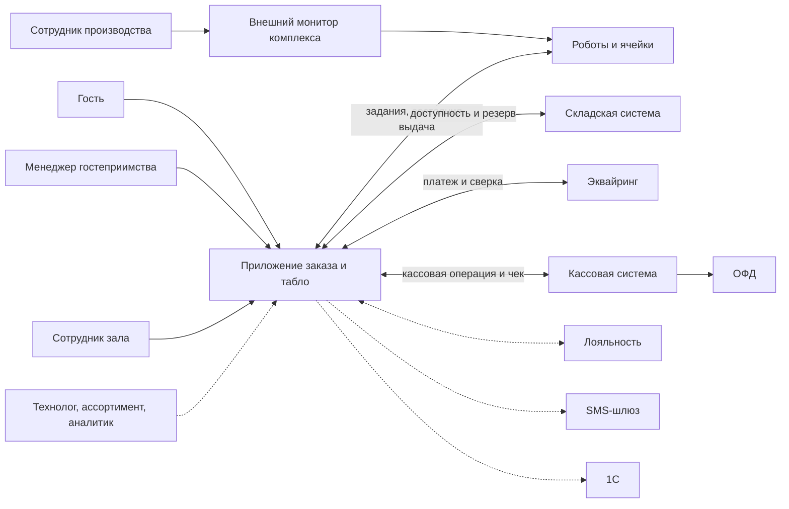
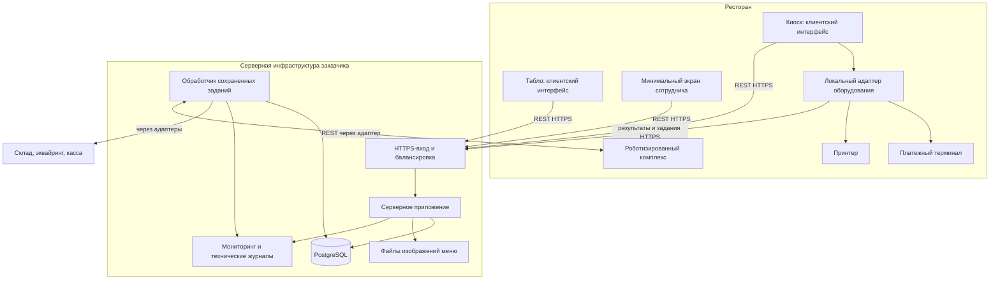

# Компоненты и размещение

Архитектура обеспечивает киоск, табло и минимальную помощь сотрудника в MVP. Полные рабочие места, лояльность, наличные, собственный монитор производства и отчетность добавляются в первом релизе. Выбранный стиль описан [отдельно](style.md).

## Контекст системы

Схема соответствует уровню контекста C4: приложение показано как одна система, остальные участники находятся снаружи. Штриховые связи обозначают первый релиз.

[Открыть схему в полном размере](../assets/stage2-components-1.svg).

Связь кассы с ОФД — требуемая граница ответственности. Конкретный маршрут и возможность прямого интерфейса подтверждаются поставщиком. В MVP менеджер дополнительно использует внешние средства возврата. Приложение не проводит платежи и не управляет опасными операциями робота.

## Контейнеры

[Открыть схему в полном размере](../assets/stage2-components-2.svg).

Backend и Worker собираются из одной кодовой базы. Это два режима запуска, а не независимые микросервисы с собственными БД. Локальный адаптер обращается к оборудованию через поддерживаемый SDK; его наличие и совместимость с ОС проверяются по A-14. Киоски не подключаются к БД.

Приложение размещается централизованно в инфраструктуре заказчика. В ресторане нет автономной копии заказов, разрешающей продажи без связи. Переход к локальным серверам и синхронизации нескольких центров записи в MVP не предусмотрен.

## Внутренние компоненты

| ID | Компонент и данные | Ответственность | Релиз |
|---|---|---|---|
| C-01 | Каталог: MenuVersion, MenuEntry, RecipeVersion, PromotionRule, проекция доступности | Меню, состав, аллергены, цены, скидки, доступность, версии по торговому дню | MVP; редакторы US-27–30 — первый релиз |
| C-02 | Оформление: Session, Cart, Order, OrderLine | Сессии, снимок покупки, суммы, последовательность жизненного цикла | MVP |
| C-03 | Резерв: Reservation, внешние ссылки | Проверка и резерв всех ингредиентов, удержание и освобождение, сверка неизвестного результата | MVP |
| C-04 | Расчеты: PaymentAttempt, Refund | Учет результата оплаты, блокировка повтора, сверка. В MVP возврат запускается снаружи | MVP; запуск возврата/наличные — первый релиз |
| C-05 | Приготовление и выдача: KitchenJob, CellAssignment, Ticket, ссылки оборудования | Доставка исходного задания, состояния, срок, право доступа, проекция табло | MVP |
| C-06 | Документы: FiscalOperation, PrintTask | Кассовая операция, получение чека, печать и восстановление талона | MVP |
| C-07 | Помощь и доступ: Problem, Notification, Employee, Role | Вход сотрудника, права по роли/ресторану, прием проблемы, поиск и ручной разбор | MVP; полный поиск US-23/26 — первый релиз |
| C-08 | Эксплуатация: Restaurant, TradingDay, AuditEvent, DeliveryTask, обработанные события | Остановка/возобновление, торговый день, надежная доставка, аудит и контроль готовности | MVP |
| C-09 | Лояльность и подарок: LoyaltyProfileRef, BonusOperationRef, GiftAllocation | Связь с внешней лояльностью, SMS и резерв подарка по A-10 | Первый релиз |
| C-10 | Отчетность: ExportBatch, ExportLine | Отчеты A-13, выгрузка в 1С и сверка повторов | Первый релиз |

Состояние заказа изменяет C-02 по проверенным событиям C-04/C-05 и решениям C-07. Каждый модуль владеет записью своих сущностей; межмодульные изменения проходят через внутренние интерфейсы. C-08 обеспечивает общую транзакцию и доставку, но не принимает продуктовых решений вместо владельцев.

Гость получает только данные текущей защищенной сессии и публичную проекцию табло. Менеджер ищет заказ по ресторану, дню и номеру; при сбое талона — из связанной проблемы. Сотрудник зала не получает полномочия возврата или повторной печати.

## Сохранность и восстановление

Серверное приложение работает в нескольких экземплярах с балансировкой запросов. PostgreSQL имеет основной и синхронный резервный узлы. Копии хранятся отдельно от рабочей БД. При отказе выполняется переключение с защитой от одновременной записи двух основных узлов. Если надежное сохранение результатов недоступно, новые продажи останавливаются, начатые операции сверяются.

При программном сбое подтвержденные записи сохраняются (RPO = 0). Приложение подтверждает операцию после надежной записи результата. Потерянный ответ банка восстанавливается сверкой исходной попытки оплаты. Ежедневные копии хранятся 30 дней и дополняются журналом изменений БД (WAL). Восстановление из копии проверяется раз в месяц.

После обнаружения одиночного программного сбоя оформление заказов восстанавливается не дольше чем за 5 мин. Восстановление включает перезапуск или переключение, возобновление обработки заданий, сверку оплаченных заказов и проверку пути продажи. Условия восстановления после потери всей площадки определяются отдельно. Недоступность необходимых внешних систем учитывается в простое по НФТ-04.

Наблюдаемость включает: задержку задания после оплаты, возраст очередей, неподтвержденные платежи/возвраты, свежесть меню и табло, резерв, здоровье печати, проблемные ячейки, доставку/принятие проблем, режим продаж и доступность полной покупки картой. Полный телефон, карточные реквизиты и код талона в журналы не попадают.

Доступность приложения измеряется по ресторану в часы его работы: возможность завершить обычную покупку картой хотя бы на одном киоске. Доступность каждого из четырех киосков и фактическая мощность контролируются отдельно. При отказе отдельного киоска фиксируется также снижение пропускной способности.

До запуска пилота проверяются [внешние возможности](integrations.md#verification) и [нефункциональные требования](load-db.md#verification). Проверка охватывает терминалы, принтеры, склад и каналы связи наряду с серверным приложением.

Техническая основа: [синхронная репликация PostgreSQL](https://www.postgresql.org/docs/current/warm-standby.html), [переключение и защита основного узла](https://www.postgresql.org/docs/current/warm-standby-failover.html).
