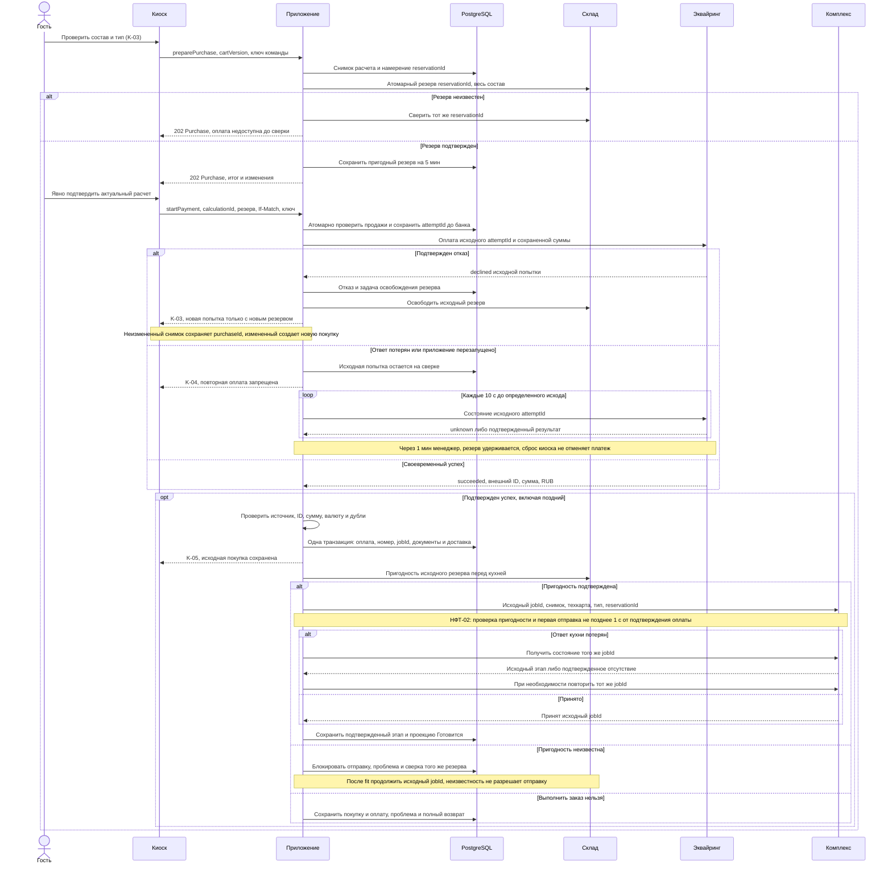
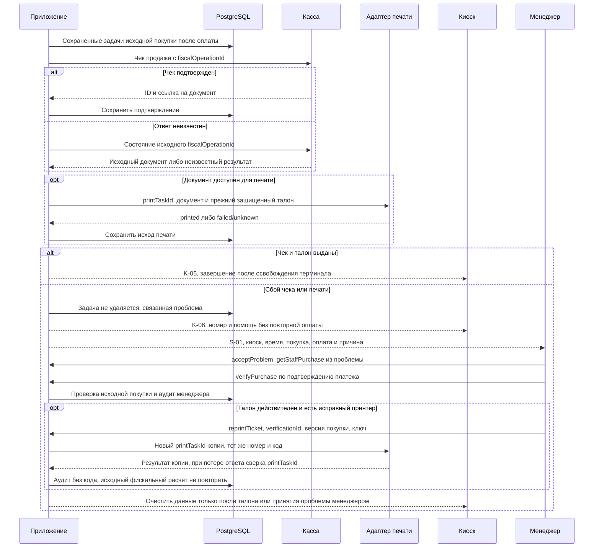
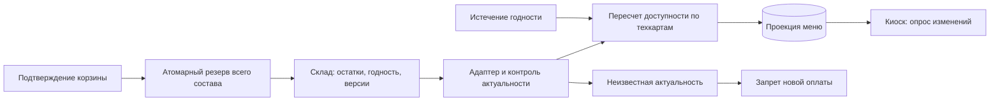
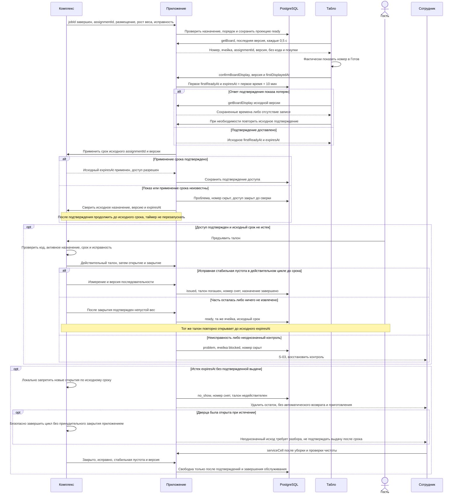
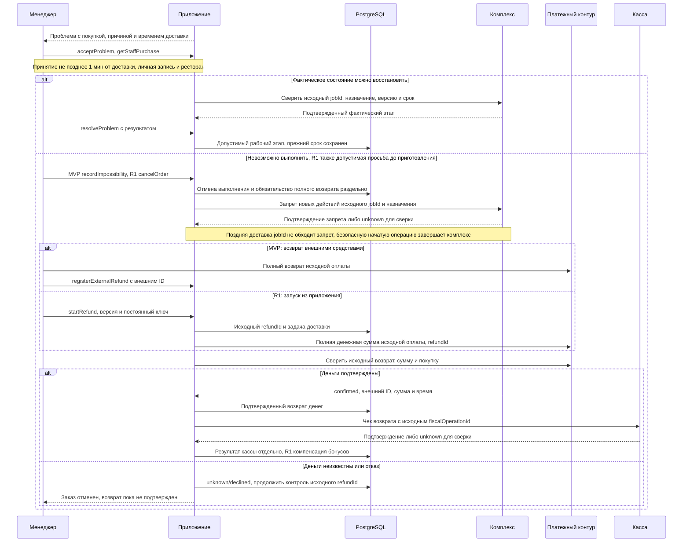
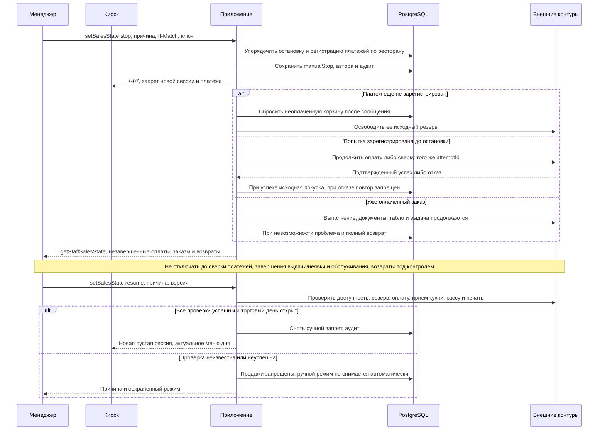

# Подробные схемы взаимодействия

Схемы показывают клиентские операции, внутренние транзакции и требуемые обмены адаптеров. Приложение — модульный монолит; обращения модулей не означают отдельные REST-сервисы. Обработчик сохраненных заданий показан как часть приложения. Стрелка с пунктиром — ответ, сплошная — команда; блоки alt/else — альтернативы, opt — условный блок, loop — повтор. Требования к полям и проверкам приведены в [контрактах адаптеров](../05_api/adapter-contracts.md); клиентские operationId — в [OpenAPI](../05_api/openapi.yaml).

## Подготовка покупки, оплата и кухня {#payment}

[Открыть схему в полном размере](../assets/stage3-flow-1.svg).

Перед каждым платежом сервер сверяет согласие с расчетом. Истекший резерв создается заново до запуска. Изменения состава и суммы требуют повторного согласия, а не автоматического списания. Повтор startPayment с тем же ключом возвращает исходный attemptId. Потеря ответа после сохранения покупки восстанавливается чтением исходного purchaseId; банк не вызывается заново. После сверки отказа применяется ветка освобождения; после сверки успеха — общий блок подтвержденной оплаты. Кухня не ожидает печати. Неизвестная пригодность и невозможность выполнения не стирают оплату. НФТ-02 измеряет первую отправку, принятие комплекса учитывается отдельно.

## Кассовая операция, печать и восстановление талона {#documents}

[Открыть схему в полном размере](../assets/stage3-flow-2.svg).

Повтор кассовой операции использует исходный fiscalOperationId. Повторная печать не является новым расчетом. Даже при unknown печати на бумаге могла выйти копия, поэтому талон сохраняет прежний код. Нельзя восстанавливать талон только по публичному номеру. После выдачи, отмены, неявки или исходного expiresAt печать действующего доступа запрещена. Если получение восстановить нельзя, используется полный возврат. Сверка документов продолжается независимо от кухни и нового торгового дня.

## Остатки и доступность {#availability}

[Открыть схему в полном размере](../assets/stage3-flow-3.svg).

Свежесть меню и защита последней порции — разные задачи. Меню обновляется p95 ≤2 с от получения приложением актуального события; перед платежом требуется атомарный резерв. Доставка события от склада измеряется отдельно. Истечение годности запускает пересчет. Пропуск версии требует актуального снимка; неизвестная актуальность немедленно запрещает оплату. Опрос меню раз в 0,5 с, 304 возможен только при подтвержденной актуальности. Пополнение выполняет внешний контур.

## Готовность, табло, срок доступа и выдача {#pickup}

[Открыть схему в полном размере](../assets/stage3-flow-4.svg).

Табло подтверждает реально показанную ему версию и исходные назначения. При отсутствии подтверждения оно повторяет исходные данные, а не начинает новый отсчет. Если само табло не может подтвердить показ, применяется ветка проблемы до разрешения доступа. Повтор, скрытие, перезапуск и другое табло не продлевают срок. Комплекс должен применять expiresAt и при потере связи (A-02). Публичный номер не открывает ячейку. Сотрудник не устанавливает issued вручную. Поздние/пропущенные события сверяются по назначению и версии; ячейка не переназначается при неизвестном исходе.

## Помощь, отмена и полный возврат {#support}

[Открыть схему в полном размере](../assets/stage3-flow-5.svg).

Невозможность исполнения в MVP позволяет фиксировать отмену, но не добавляет произвольную отмену по просьбе гостя. В R1 просьба допустима до начала приготовления; после начала нужна невозможность или подтвержденная проблема. Возврат по проблеме выданного заказа сохраняет факт issued. Частичная сумма не задается. Для наличных R1 менеджер фиксирует выдачу, но подтверждение внешнего и кассового контуров остается обязательным. Неизвестный возврат не закрывается отметкой сотрудника; отказ исправляется в рамках той же логической операции. Чек возврата и обратные бонусные операции контролируются независимо.

## Остановка продаж и начатые операции {#sales-stop}

[Открыть схему в полном размере](../assets/stage3-flow-6.svg).

Ручной запрет переживает перезапуск. Техническая ошибка сразу запрещает новую оплату, а 10 с относятся только к сообщению недоступности. Поздний успех оплаты относится к исходному торговому дню и снимку. Новое меню применяется только к новым покупкам. Режим A-16: 10:00–22:00 ежедневно; регулярные работы вне этого времени. Остановки A-15 внутри дня и сбои входят в общий бюджет 21,6 минуты за 30 дней. Отключение оборудования не выводится из одного флага остановки: проверяются обязательства A-15.
