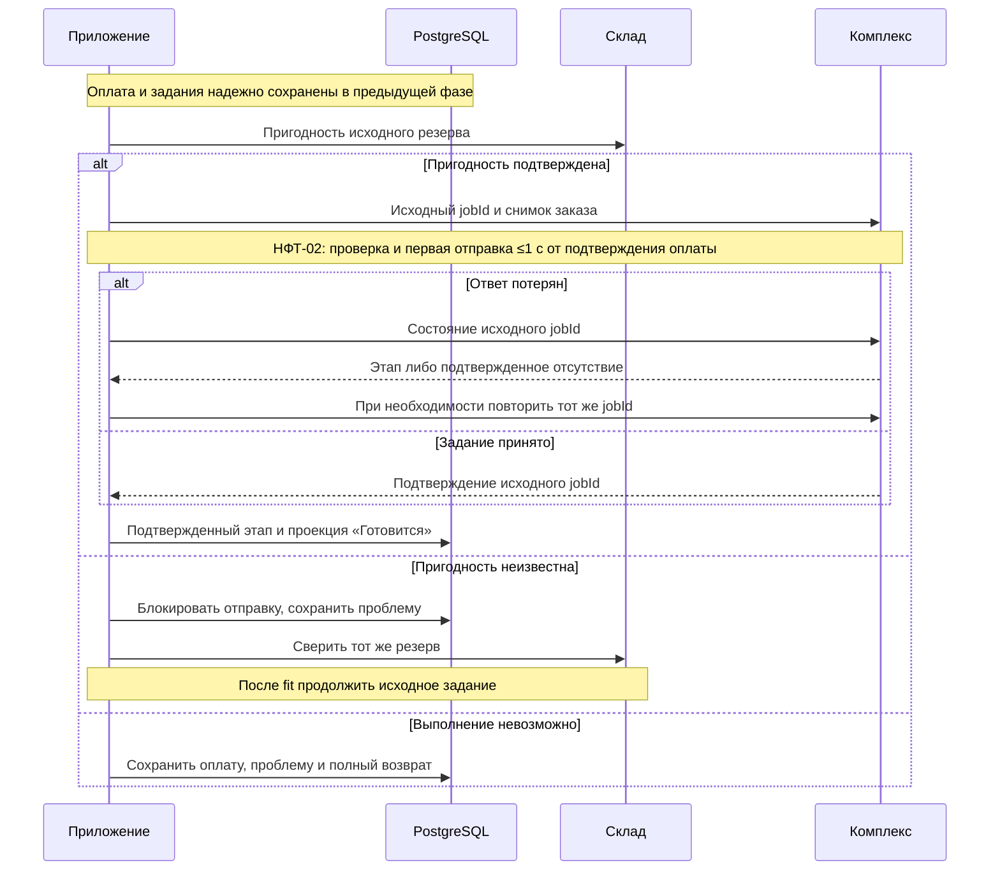
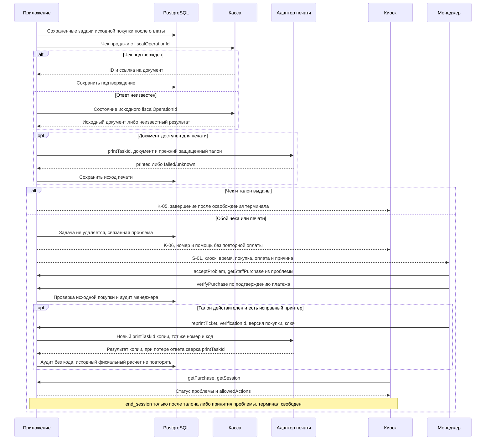
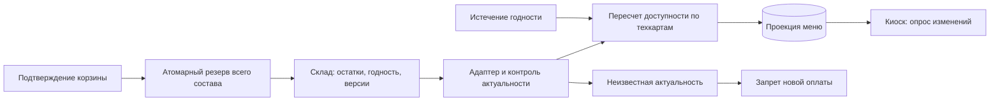
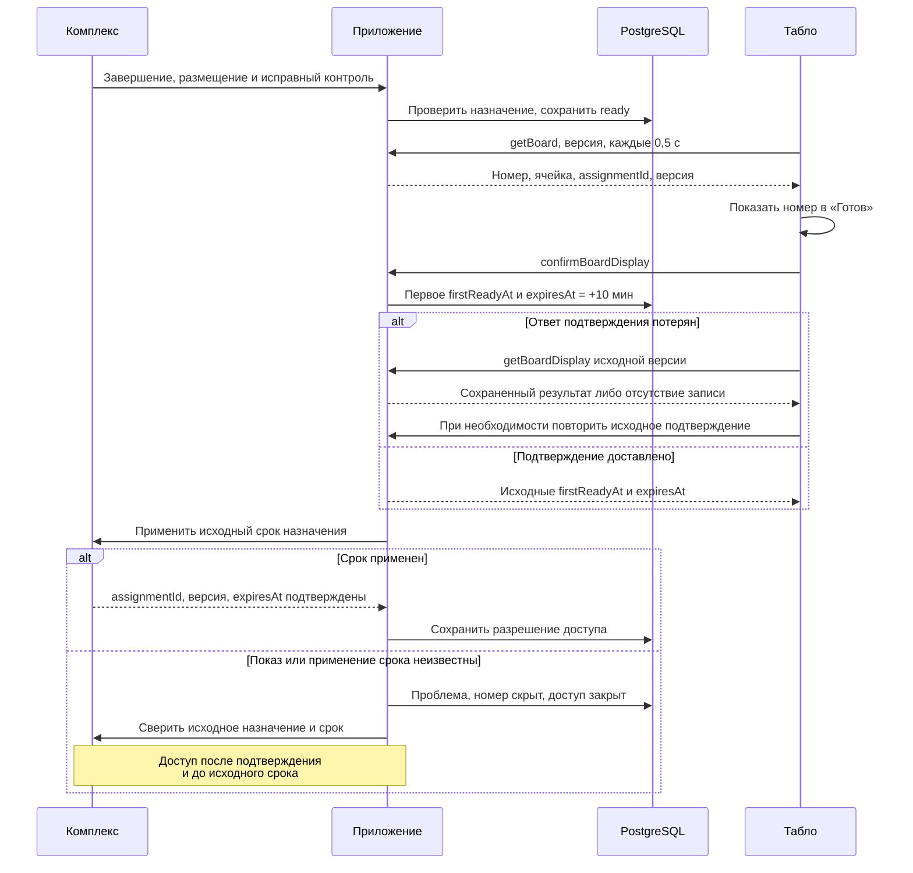
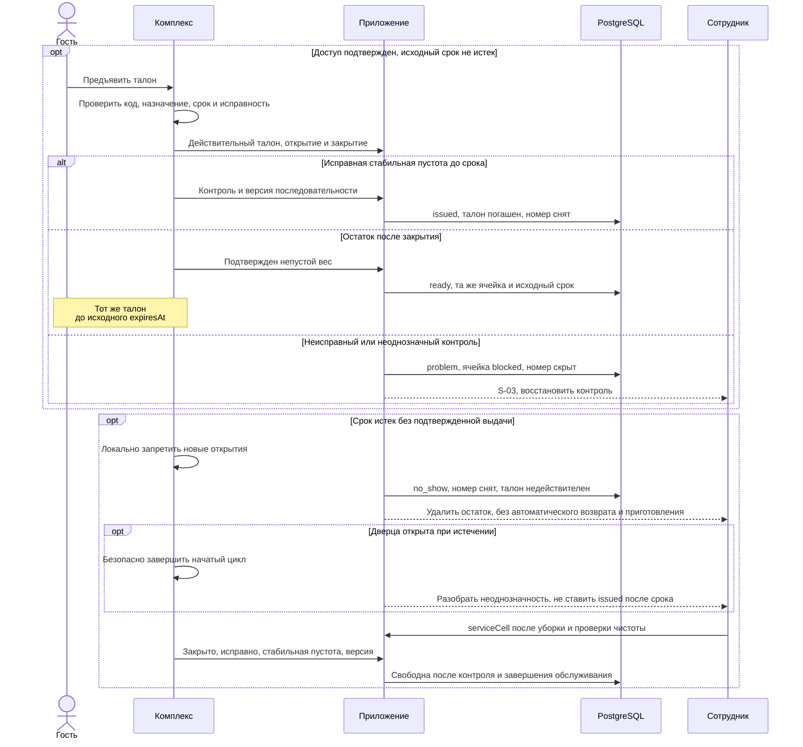
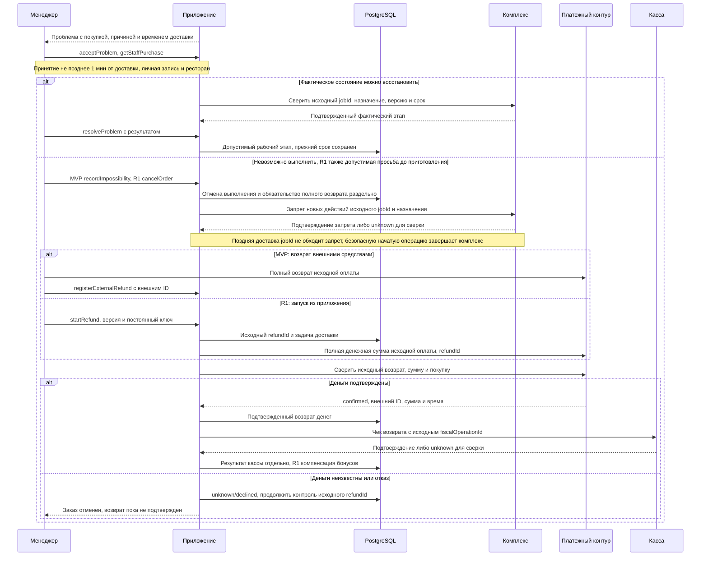
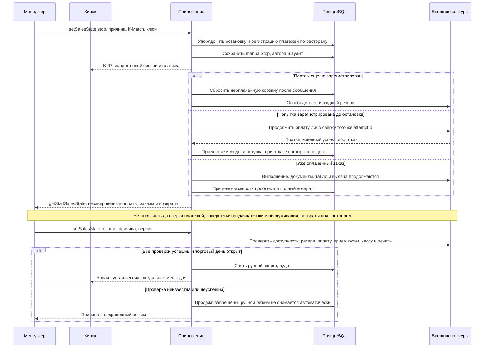

# Подробные схемы взаимодействия

Схемы показывают клиентские операции, внутренние транзакции и требуемые обмены адаптеров. Приложение — модульный монолит; обращения модулей не означают отдельные REST-сервисы. Обработчик сохраненных заданий показан как часть приложения. Стрелка с пунктиром — ответ, сплошная — команда; блоки alt/else — альтернативы, opt — условный блок, loop — повтор. Требования к полям и проверкам приведены в [контрактах адаптеров](../05_api/adapter-contracts.md); клиентские operationId — в [OpenAPI](../05_api/openapi.yaml).

## Подготовка покупки и оплата {#payment}

```mermaid
sequenceDiagram
actor Guest as Гость
participant Kiosk as Киоск
participant App as Приложение
participant DB as PostgreSQL
participant Stock as Склад
participant Pay as Эквайринг
Guest->>Kiosk: Проверить состав и тип
Kiosk->>App: preparePurchase
App->>DB: Снимок и намерение резерва
App->>Stock: Атомарный резерв всего состава
alt Результат резерва неизвестен
App->>Stock: Сверить исходный reservationId
App-->>Kiosk: Оплата недоступна до сверки
else Резерв подтвержден на 5 мин
App->>DB: Сохранить пригодный резерв
App-->>Kiosk: Расчет и изменения
Guest->>Kiosk: Подтвердить актуальный итог
Kiosk->>App: startPayment
App->>DB: Проверить условия, сохранить attemptId до банка
App->>Pay: Исходный attemptId и сумма
alt Ответ потерян или приложение перезапущено
App-->>Kiosk: K-04, повторная оплата запрещена
Note over App,Pay: Резерв удерживается, через 1 мин уведомить менеджера
loop Каждые 10 с до определенного исхода
App->>Pay: Состояние исходной попытки
Pay-->>App: unknown либо определенный результат
end
else Ответ получен
Pay-->>App: succeeded либо declined
end
alt Подтвержден отказ
App->>DB: Отказ и задача освобождения резерва
App->>Stock: Освободить исходный резерв
App-->>Kiosk: K-03, новый резерв после сверки освобождения
else Подтвержден успех, включая поздний
App->>App: Проверить источник, ID, сумму, RUB и дубли
App->>DB: Атомарно: оплата, номер, jobId, документы, доставка
App-->>Kiosk: K-05, исходная покупка сохранена
end
end
```

[Открыть схему в полном размере](../assets/stage3-flow-1.svg).

Условия расчета, повторного согласия и новой попытки — в [правилах покупки](../05_api/resources.md#calculation). Неизмененный снимок сохраняет purchaseId, изменение создает новую покупку. После перезапуска киоск [восстанавливает исходную сессию и покупку](../05_api/resources.md#retries). Сохраненный успех запускает две независимые ветки: кухню и документы.

## Передача оплаченной покупки на кухню {#kitchen}

[Открыть схему в полном размере](../assets/stage3-flow-2.svg).

Поля задания — в [контракте I-03](../05_api/adapter-contracts.md). Кухня не ждет печати. Неизвестная пригодность и невозможность выполнения не стирают оплату. НФТ-02 измеряет первую отправку; принятие комплекса учитывается отдельно.

## Кассовая операция, печать и восстановление талона {#documents}

[Открыть схему в полном размере](../assets/stage3-flow-3.svg).

Повтор кассовой операции использует исходный fiscalOperationId. Повторная печать не является новым расчетом. Даже при unknown печати на бумаге могла выйти копия, поэтому талон сохраняет прежний код. Нельзя восстанавливать талон только по публичному номеру. После выдачи, отмены, неявки или исходного expiresAt печать действующего доступа запрещена. Если получение восстановить нельзя, используется полный возврат. Сверка документов продолжается независимо от кухни и нового торгового дня.

## Остатки и доступность {#availability}

[Открыть схему в полном размере](../assets/stage3-flow-4.svg).

Свежесть меню и защита последней порции — разные задачи. Меню обновляется p95 ≤2 с от получения приложением актуального события; перед платежом требуется атомарный резерв. Доставка события от склада измеряется отдельно. Истечение годности запускает пересчет. Пропуск версии требует актуального снимка; неизвестная актуальность немедленно запрещает оплату. Опрос меню раз в 0,5 с, 304 возможен только при подтвержденной актуальности. Пополнение выполняет внешний контур.

## Готовность, табло и установка срока {#pickup}

[Открыть схему в полном размере](../assets/stage3-flow-5.svg).

До подтверждения первого показа C-05 выдает назначение одному закрепленному табло. Его ID сохраняется вместе с назначением. После фиксации первого времени номер доступен всем табло ресторана. При невозможности подтвердить сам показ доступ также закрыт до сверки. Повторы, скрытие номера, перезапуск и несколько табло не продлевают срок; обработка времени описана в [правилах табло](../05_api/resources.md#board). Комплекс применяет expiresAt даже без связи (A-02). После подтверждения доступа начинается [выдача](#issue).

## Выдача, истечение срока и обслуживание {#issue}

[Открыть схему в полном размере](../assets/stage3-flow-6.svg).

Публичный номер не открывает ячейку; сотрудник не устанавливает issued вручную. Пропущенные и поздние события сверяются по назначению и версии. При неизвестном исходе ячейка не переназначается. Безопасное завершение открытого цикла и восстановление контроля — в [контракте комплекса](../05_api/adapter-contracts.md).

## Помощь, отмена и полный возврат {#support}

[Открыть схему в полном размере](../assets/stage3-flow-7.svg).

Невозможность исполнения в MVP позволяет фиксировать отмену, но не добавляет произвольную отмену по просьбе гостя. В R1 просьба допустима до начала приготовления; после начала нужна невозможность или подтвержденная проблема. Возврат по проблеме выданного заказа сохраняет факт issued. Частичная сумма не задается. Для наличных R1 менеджер фиксирует выдачу, но подтверждение внешнего и кассового контуров остается обязательным. Неизвестный возврат не закрывается отметкой сотрудника; отказ исправляется в рамках той же логической операции. Чек возврата и обратные бонусные операции контролируются независимо.

## Остановка продаж и начатые операции {#sales-stop}

[Открыть схему в полном размере](../assets/stage3-flow-8.svg).

Ручной запрет переживает перезапуск. Техническая ошибка сразу запрещает новую оплату, а 10 с относятся только к сообщению недоступности. Поздний успех оплаты относится к исходному торговому дню и снимку. Новое меню применяется только к новым покупкам. Режим A-16: 10:00–22:00 ежедневно; регулярные работы вне этого времени. Остановки A-15 внутри дня и сбои входят в общий бюджет 21,6 минуты за 30 дней. Отключение оборудования не выводится из одного флага остановки: проверяются обязательства A-15.
