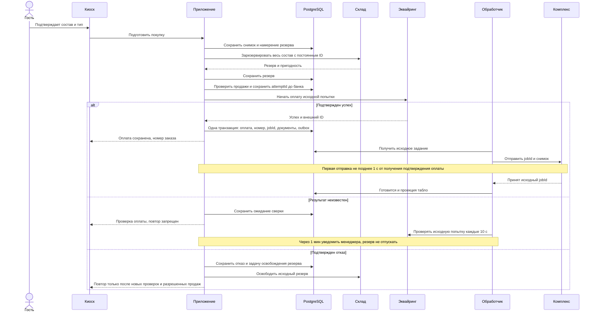
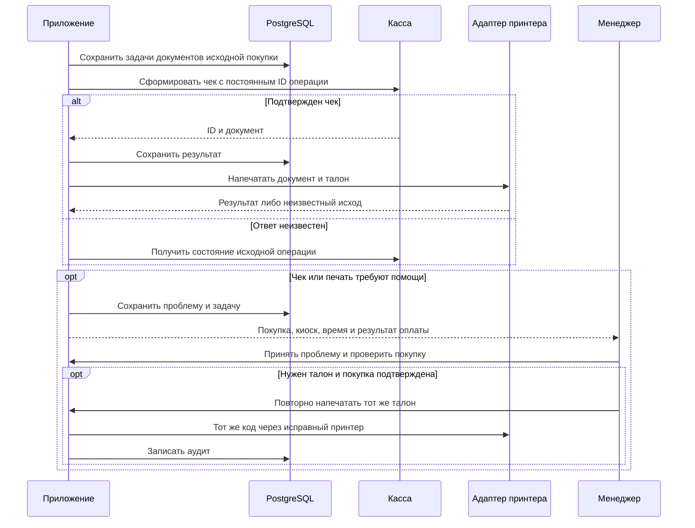
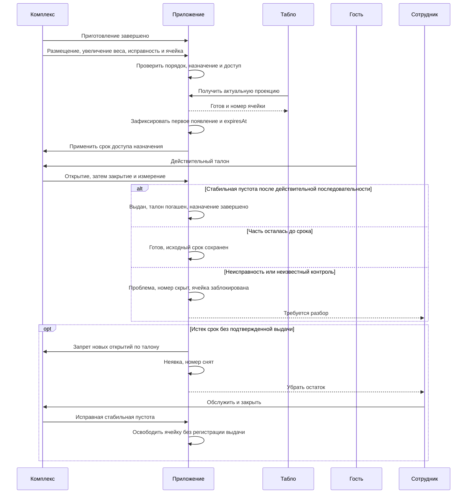

# Схемы интеграций

Схемы определяют порядок взаимодействия компонентов и точки сохранения результатов. Поля сообщений, коды ошибок и тайм-ауты задаются контрактами API. Назначение обменов и необходимые возможности приведены в [реестре интеграций](integrations.md).

## Оплата и передача на кухню

[Открыть схему в полном размере](../assets/stage2-integration-flows-1.svg).

Если ответ резерва потерян, перед оплатой сверяется исходный ID. Если ответ кухни потерян, проверяется исходный jobId; новое приготовление не создается. Сбой приложения после списания до записи ответа восстанавливает покупку по attemptId. После неуспешных попыток передачи оплаченный заказ остается на контроле до подтвержденного результата или отмены с возвратом.

## Касса и печать

[Открыть схему в полном размере](../assets/stage2-integration-flows-2.svg).

Кухня не ожидает успеха печати после сохраненной оплаты. Повтор кассового запроса использует тот же ID; повторная печать не создает кассовый расчет. При неизвестной печати возможна копия того же талона, но не новая покупка. До выдачи талона либо принятия проблемы менеджером киоск не начинает следующую сессию. Терминал дополнительно должен безопасно завершить предыдущий платеж.

В MVP невозможность выполнения фиксируется в минимальном экране. Менеджер проводит полный возврат внешними средствами; приложение сохраняет ID, сверяет его с провайдером и кассой. В первом релизе тот же процесс запускается из приложения. Неподтвержденный возврат остается на контроле, даже если заказ уже отменен.

## Остатки и доступность

[Открыть схему в полном размере](../assets/stage2-integration-flows-3.svg).

Свежесть меню и защита последней порции — разные задачи. Меню обновляется p95 ≤2 с от получения приложением актуального события, резерв проверяется перед каждым платежом. Доставка события от склада измеряется отдельно. Пополнение выполняет внешний контур; приложение не создает заявки за сутки или в течение 5 часов.

## Готовность, выдача и табло

[Открыть схему в полном размере](../assets/stage2-integration-flows-4.svg).

Начало хранения согласуется с первым подтвержденным показом табло, а не с одним завершением приготовления. Табло подтверждает примененную версию проекции; повтор не меняет firstReadyAt. До показа и установки срока комплекс не должен предоставлять гостю доступ. Потеря подтверждения показа восстанавливается по версии; таймер никогда не начинается заново. Если подтвержденную доступную выдачу организовать нельзя, фиксируется проблема. Надежность этой последовательности и локального expiresAt — условие A-02, проверяемое на стенде.

Опрос табло и меню — раз в 0,5 с при активном экране. Для отсутствия изменений используются версия/условный ответ, но сам запрос учитывается в нагрузке. При неизвестной актуальности табло не оставляет старое обещание доступной выдачи; показывает недоступность данных и подсказку о менеджере.

Плановая остановка блокирует только новые сессии и платежи. Эти потоки продолжают обслуживать старые покупки. Новое меню применяется к новым покупкам; сверка, возврат и выдача сохраняют исходный торговый день.
