# Прототипы экранов

[Открыть кликабельный прототип](../assets/prototype/index.html).

Прототип показывает расположение элементов, размеры рабочих областей, формы, окна подтверждения и переходы. Цены, состав блюд, сотрудники и состояния приведены как демонстрационные данные. Реальные операции оплаты, возврата, печати и выдачи не выполняются.

В левой панели выбирается экран, сверху — его состояние и масштаб. Панель демонстрации над экраном моделирует ответы терминала, принтера, комплекса и внешних систем. Эти элементы управления не входят в пользовательский интерфейс. Для просмотра без уменьшения выберите масштаб 100%.

Киоск: портретный экран 900 × 1360. Рабочие места: 1440 × 1000. Табло и экран выдачи: 1440 × 900. Это размеры прототипов, а не требования к модели оборудования.

Каждое изображение открывается отдельно в полном размере. Назначение экранов и связь действий с API приведены в [описании UI](ui.md).

## Киоск — MVP {#kiosk}

| **K-01 · Каталог** | **K-02 · Карточка блюда и дополнения** |
|---|---|
| [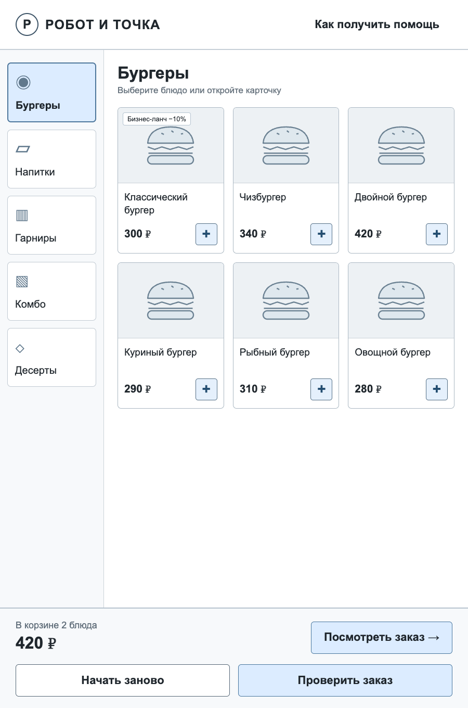{width="300"}](../assets/prototype/screens/k-01-default.png) | [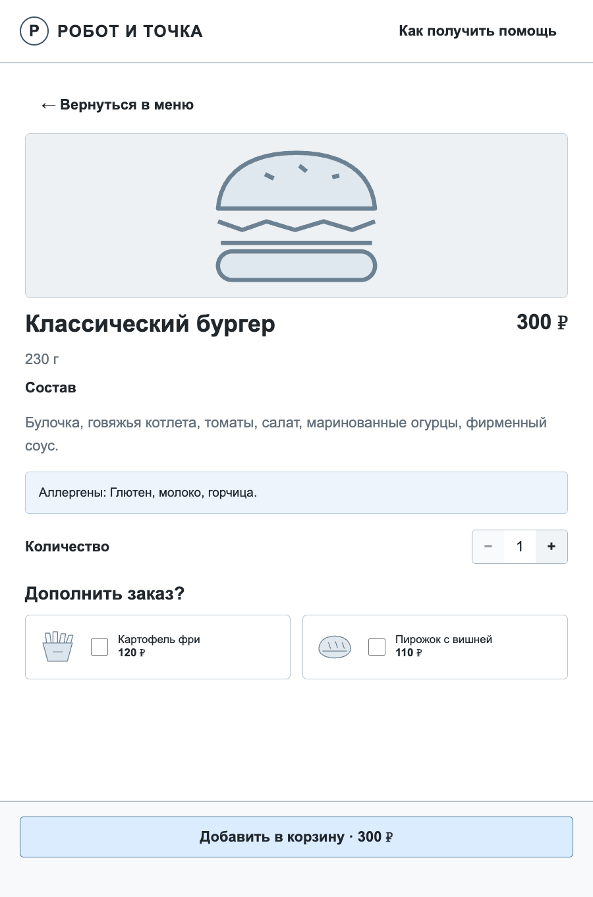{width="300"}](../assets/prototype/screens/k-02-default.png) |
| [Открыть прототип](../assets/prototype/index.html?screen=K-01) · Гость · MVP | [Открыть прототип](../assets/prototype/index.html?screen=K-02) · Гость · MVP |

**K-01, состояния:** [Загрузка](../assets/prototype/screens/k-01-loading.png) · [Нет доступных блюд](../assets/prototype/screens/k-01-empty.png) · [Ошибка связи](../assets/prototype/screens/k-01-error.png) · [Предупреждение о бездействии](../assets/prototype/screens/k-01-idle.png).

**K-02, состояния:** [Блюдо стало недоступно](../assets/prototype/screens/k-02-unavailable.png).

| **K-03 · Корзина и подтверждение** |  |
|---|---|
| [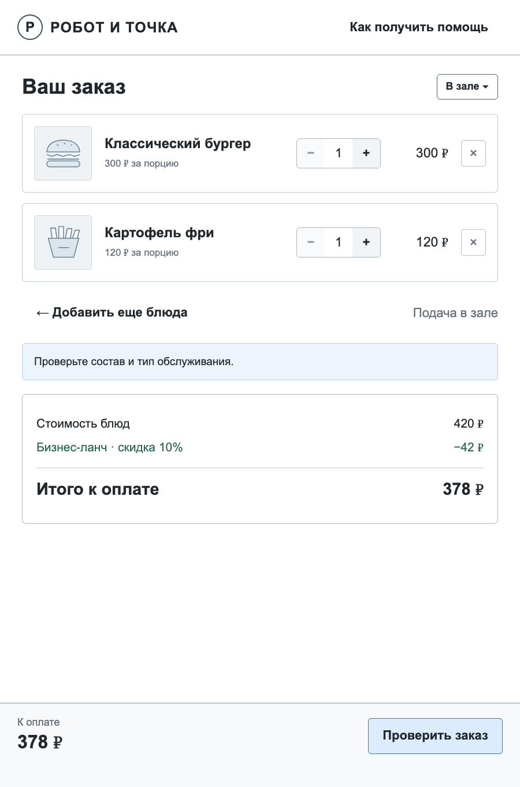{width="300"}](../assets/prototype/screens/k-03-default.png) |  |
| [Открыть прототип](../assets/prototype/index.html?screen=K-03) · Гость · MVP |  |

**K-03, состояния:** [Выбор типа обслуживания](../assets/prototype/screens/k-03-type.png) · [Расчет проверен](../assets/prototype/screens/k-03-confirmed.png) · [Изменилась цена](../assets/prototype/screens/k-03-changed.png) · [Позиция недоступна](../assets/prototype/screens/k-03-unavailable.png) · [Пустая корзина](../assets/prototype/screens/k-03-empty.png).

## Оплата и документы — MVP {#payment}

| **K-04 · Оплата картой** | **K-05 · Оплата подтверждена** |
|---|---|
| [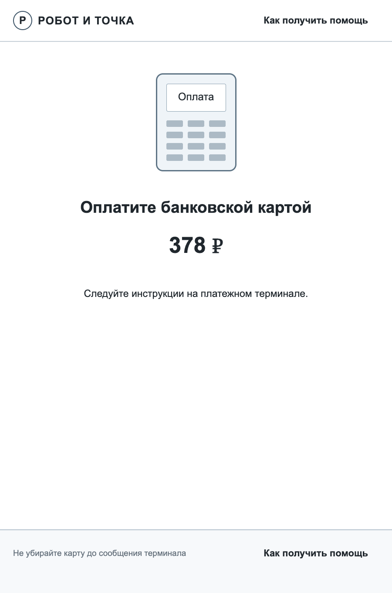{width="300"}](../assets/prototype/screens/k-04-default.png) | [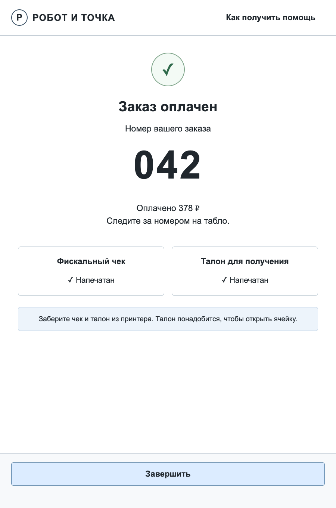{width="300"}](../assets/prototype/screens/k-05-default.png) |
| [Открыть прототип](../assets/prototype/index.html?screen=K-04) · Гость · MVP | [Открыть прототип](../assets/prototype/index.html?screen=K-05) · Гость · MVP |

**K-04, состояния:** [Проверка неизвестного платежа](../assets/prototype/screens/k-04-unknown.png) · [Подтвержденный отказ](../assets/prototype/screens/k-04-declined.png).

**K-05, состояния:** [Печать документов](../assets/prototype/screens/k-05-printing.png).

| **K-06 · Помощь после оплаты** | **K-07 · Продажи приостановлены** |
|---|---|
| [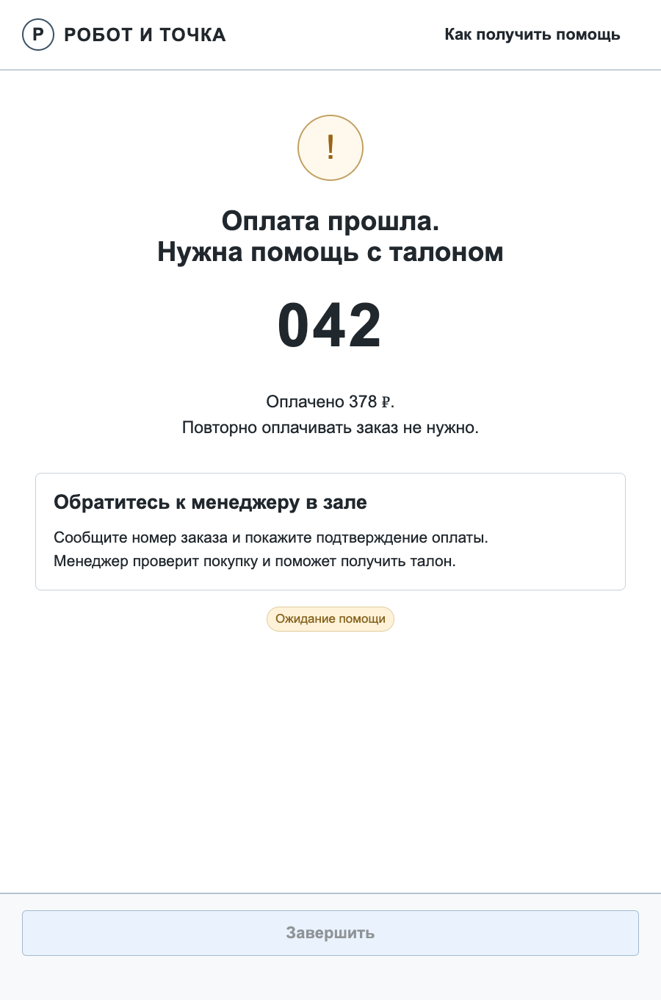{width="300"}](../assets/prototype/screens/k-06-default.png) | [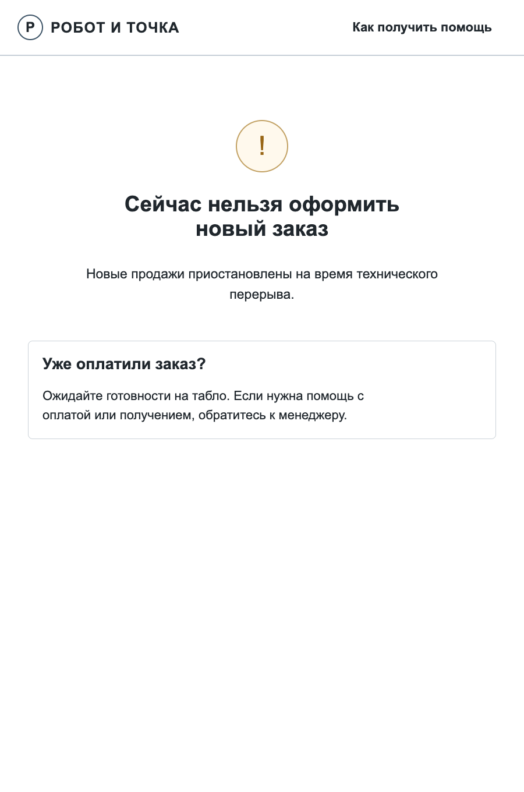{width="300"}](../assets/prototype/screens/k-07-default.png) |
| [Открыть прототип](../assets/prototype/index.html?screen=K-06) · Гость · MVP | [Открыть прототип](../assets/prototype/index.html?screen=K-07) · Гость · MVP |

**K-06, состояния:** [Проблема принята менеджером](../assets/prototype/screens/k-06-accepted.png).

**K-07, состояния:** [Нет необходимой связи](../assets/prototype/screens/k-07-technical.png).

## Табло и выдача — MVP {#board}

| **B-01 · Табло готовности** | **B-02 · Экран устройства выдачи** |
|---|---|
| [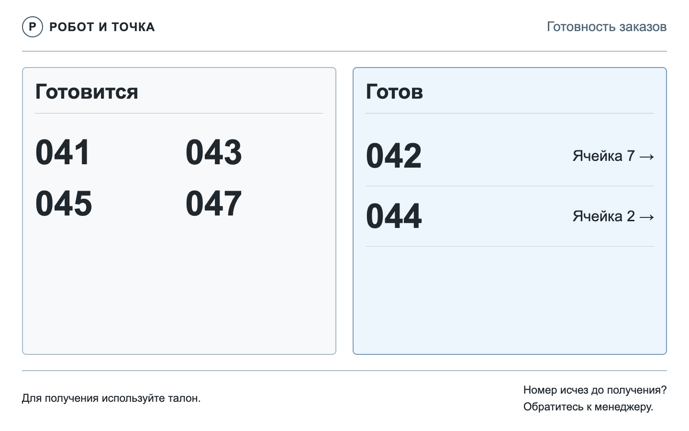{width="300"}](../assets/prototype/screens/b-01-default.png) | [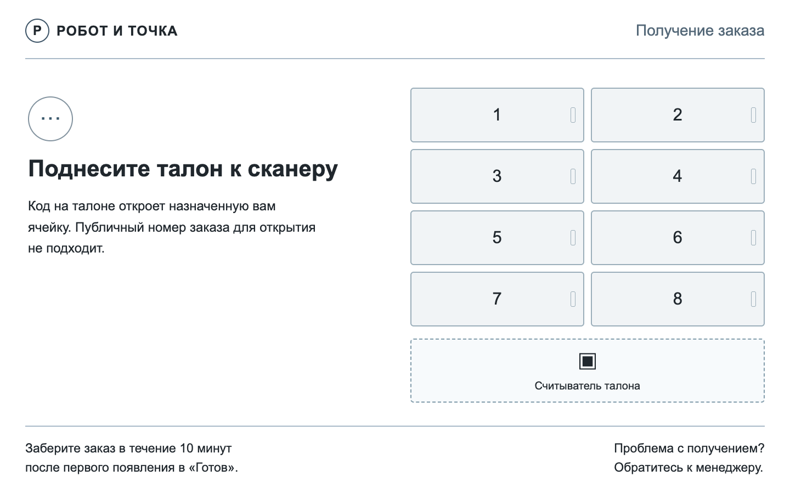{width="300"}](../assets/prototype/screens/b-02-default.png) |
| [Открыть прототип](../assets/prototype/index.html?screen=B-01) · Посетители · MVP | [Открыть прототип](../assets/prototype/index.html?screen=B-02) · Гость с талоном · MVP |

**B-01, состояния:** [Нет заказов](../assets/prototype/screens/b-01-empty.png) · [Загрузка данных](../assets/prototype/screens/b-01-loading.png) · [Данные недоступны](../assets/prototype/screens/b-01-error.png).

**B-02, состояния:** [Дверца открыта](../assets/prototype/screens/b-02-open.png) · [Частичное получение](../assets/prototype/screens/b-02-partial.png) · [Выдача подтверждена](../assets/prototype/screens/b-02-issued.png) · [Срок истек](../assets/prototype/screens/b-02-expired.png) · [Неверный талон](../assets/prototype/screens/b-02-invalid.png) · [Неисправность контроля](../assets/prototype/screens/b-02-fault.png).

## Минимальный экран — MVP {#staff}

| **S-00 · Вход сотрудника** | **S-01 · Проблемы и точный поиск** |
|---|---|
| [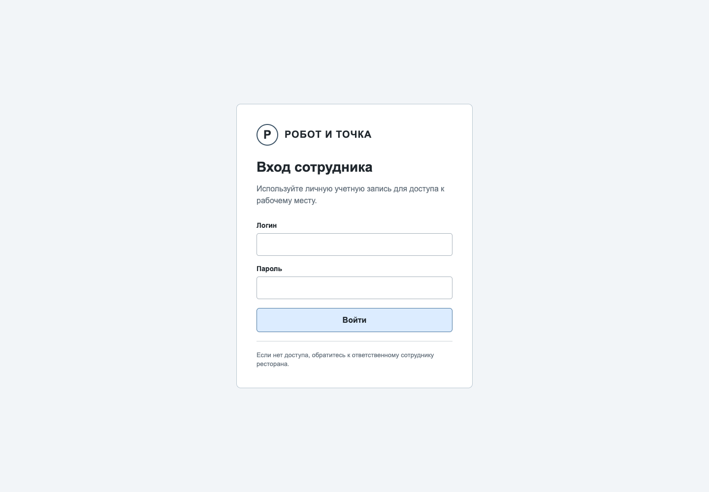{width="300"}](../assets/prototype/screens/s-00-default.png) | [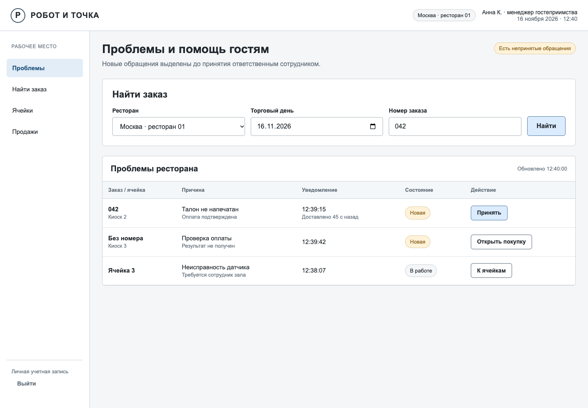{width="300"}](../assets/prototype/screens/s-01-default.png) |
| [Открыть прототип](../assets/prototype/index.html?screen=S-00) · Сотрудник · MVP | [Открыть прототип](../assets/prototype/index.html?screen=S-01) · Менеджер гостеприимства · MVP |

**S-00, состояния:** [Неверные учетные данные](../assets/prototype/screens/s-00-error.png).

**S-01, состояния:** [Проблема принята](../assets/prototype/screens/s-01-accepted.png) · [Нет проблем](../assets/prototype/screens/s-01-empty.png) · [Загрузка](../assets/prototype/screens/s-01-loading.png) · [Ошибка связи](../assets/prototype/screens/s-01-error.png).

| **S-02 · Покупка и помощь** | **S-03 · Обслуживание ячеек** |
|---|---|
| [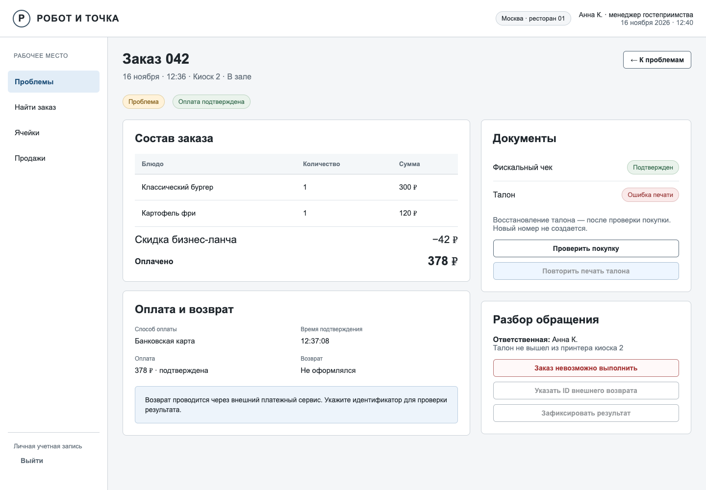{width="300"}](../assets/prototype/screens/s-02-default.png) | [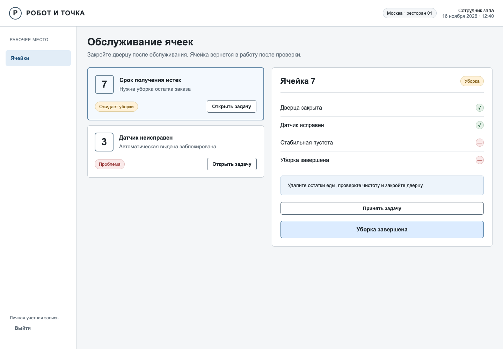{width="300"}](../assets/prototype/screens/s-03-default.png) |
| [Открыть прототип](../assets/prototype/index.html?screen=S-02) · Менеджер гостеприимства · MVP | [Открыть прототип](../assets/prototype/index.html?screen=S-03) · Сотрудник зала · MVP |

**S-02, состояния:** [Покупка с неизвестной оплатой](../assets/prototype/screens/s-02-paymentUnknown.png) · [Проверка покупки](../assets/prototype/screens/s-02-verify.png) · [Покупка проверена](../assets/prototype/screens/s-02-verified.png) · [Талон напечатан](../assets/prototype/screens/s-02-reprinted.png) · [Проблема решена](../assets/prototype/screens/s-02-resolved.png) · [Невозможность выполнения](../assets/prototype/screens/s-02-cancel.png) · [Заказ отменен; возврат требуется](../assets/prototype/screens/s-02-cancelled.png) · [Регистрация внешнего возврата](../assets/prototype/screens/s-02-refund.png) · [Возврат проверяется](../assets/prototype/screens/s-02-refundPending.png) · [Возврат подтвержден](../assets/prototype/screens/s-02-refundConfirmed.png).

**S-03, состояния:** [Контроль после уборки](../assets/prototype/screens/s-03-checking.png) · [Датчик неисправен](../assets/prototype/screens/s-03-fault.png) · [Нет задач](../assets/prototype/screens/s-03-empty.png).

| **S-04 · Продажи и начатые операции** |  |
|---|---|
| [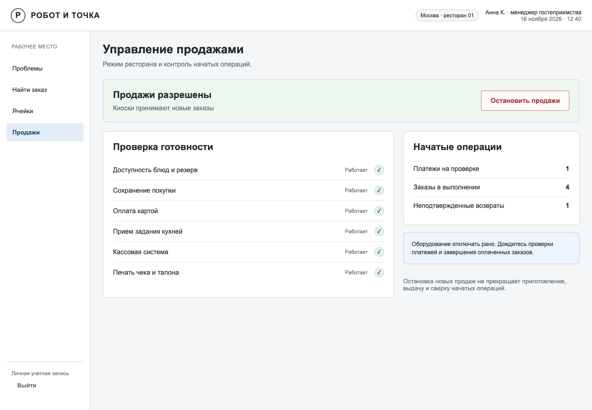{width="300"}](../assets/prototype/screens/s-04-default.png) |  |
| [Открыть прототип](../assets/prototype/index.html?screen=S-04) · Менеджер гостеприимства · MVP |  |

**S-04, состояния:** [Подтверждение остановки](../assets/prototype/screens/s-04-stop.png) · [Ручная остановка](../assets/prototype/screens/s-04-stopped.png) · [Проверки не пройдены](../assets/prototype/screens/s-04-technical.png).

## Первый релиз — гость {#r1-guest}

| **R-01 · Вход и регистрация в лояльности** | **R-02 · Бонусы и подарок** |
|---|---|
| [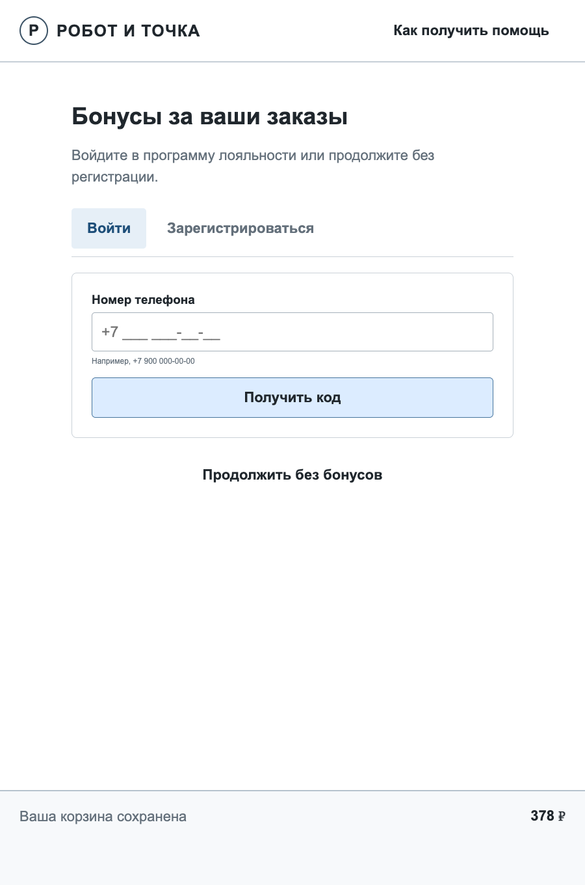{width="300"}](../assets/prototype/screens/r-01-default.png) | [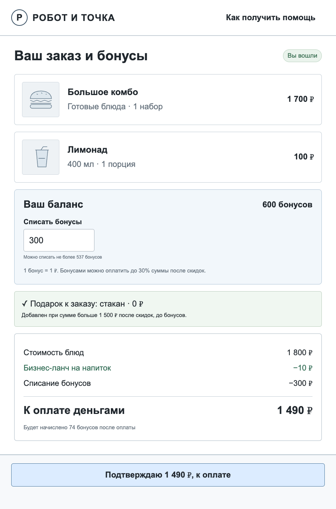{width="300"}](../assets/prototype/screens/r-02-default.png) |
| [Открыть прототип](../assets/prototype/index.html?screen=R-01) · Гость · Первый релиз | [Открыть прототип](../assets/prototype/index.html?screen=R-02) · Участник программы лояльности · Первый релиз |

**R-01, состояния:** [Регистрация](../assets/prototype/screens/r-01-register.png) · [Подтверждение SMS](../assets/prototype/screens/r-01-code.png) · [Ошибка кода](../assets/prototype/screens/r-01-error.png).

**R-02, состояния:** [Выбор способа оплаты](../assets/prototype/screens/r-02-method.png) · [Нулевой баланс](../assets/prototype/screens/r-02-noBonus.png) · [Стаканы закончились](../assets/prototype/screens/r-02-giftMissing.png).

| **R-03 · Наличная оплата** |  |
|---|---|
| [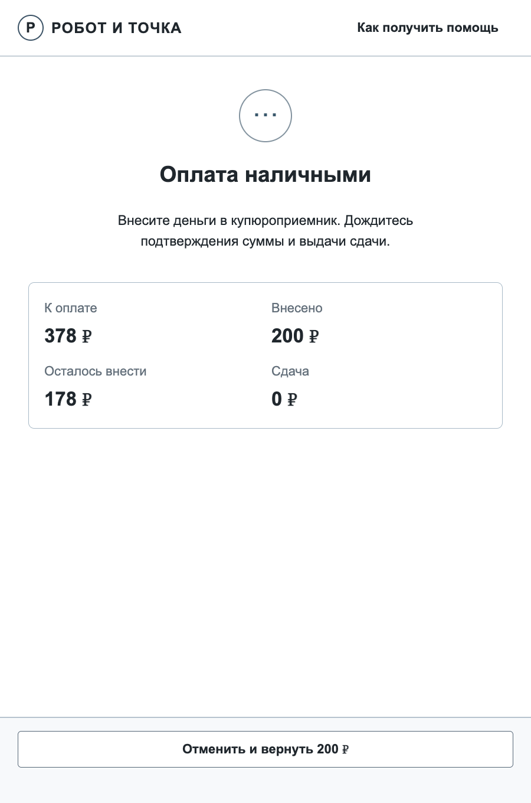{width="300"}](../assets/prototype/screens/r-03-default.png) |  |
| [Открыть прототип](../assets/prototype/index.html?screen=R-03) · Гость · Первый релиз |  |

**R-03, состояния:** [Возврат внесенных денег](../assets/prototype/screens/r-03-cancel.png) · [Результат возврата неизвестен](../assets/prototype/screens/r-03-returnUnknown.png) · [Устройство недоступно](../assets/prototype/screens/r-03-unavailable.png).

## Первый релиз — сотрудники {#r1-staff}

| **R-04 · Полное рабочее место менеджера** | **R-05 · Меню, цены, акции и комбо** |
|---|---|
| [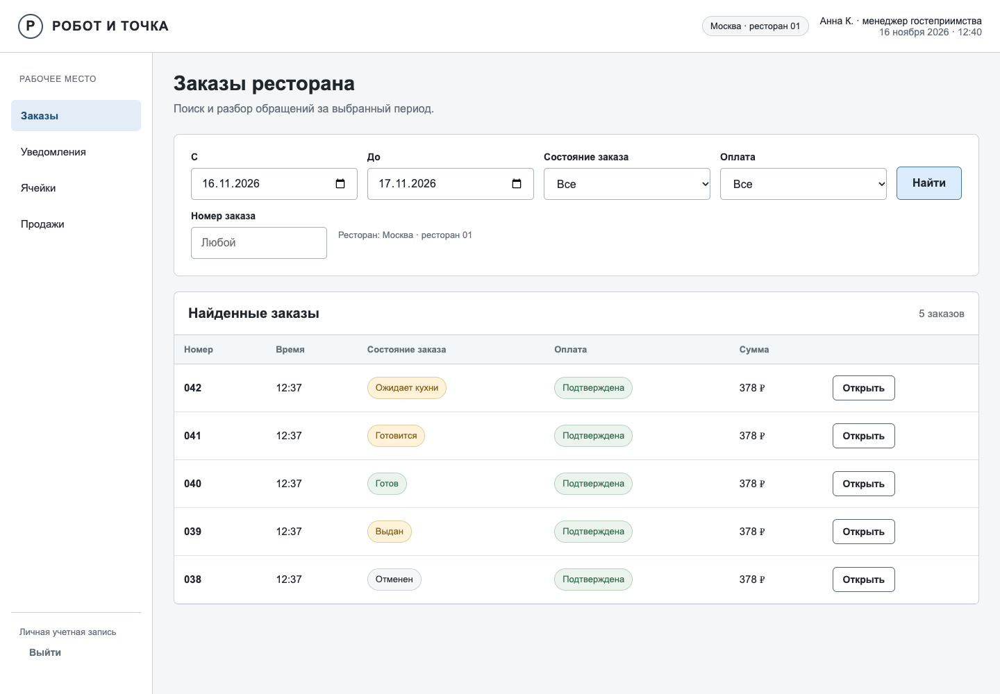{width="300"}](../assets/prototype/screens/r-04-default.png) | [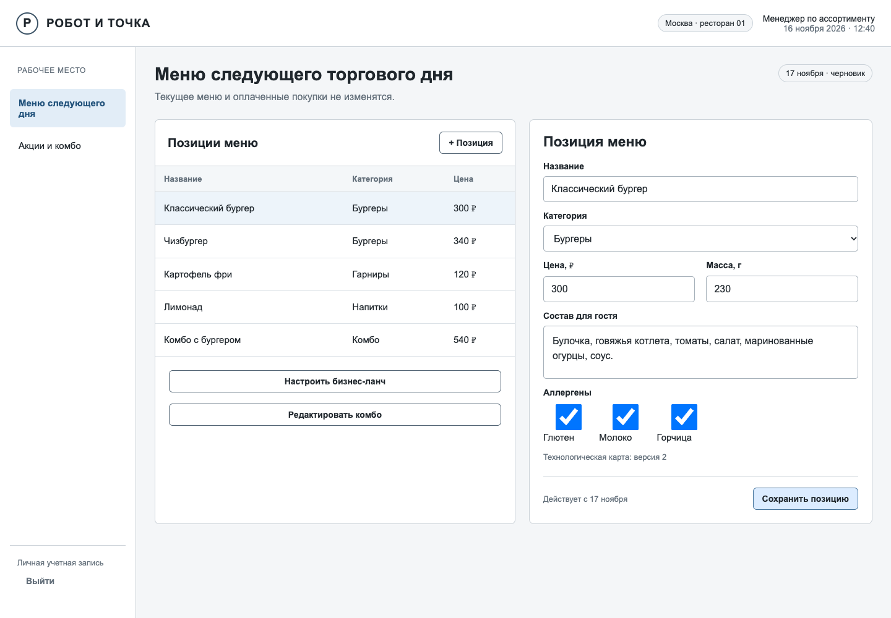{width="300"}](../assets/prototype/screens/r-05-default.png) |
| [Открыть прототип](../assets/prototype/index.html?screen=R-04) · Менеджер гостеприимства · Первый релиз | [Открыть прототип](../assets/prototype/index.html?screen=R-05) · Менеджер по ассортименту · Первый релиз |

**R-04, состояния:** [Карточка заказа](../assets/prototype/screens/r-04-detail.png) · [Подтверждение отмены](../assets/prototype/screens/r-04-cancel.png) · [Заказ отменен; возврат требуется](../assets/prototype/screens/r-04-cancelled.png) · [Полный возврат](../assets/prototype/screens/r-04-refund.png) · [Возврат проверяется](../assets/prototype/screens/r-04-refundPending.png) · [Возврат подтвержден](../assets/prototype/screens/r-04-refundConfirmed.png) · [Уведомления](../assets/prototype/screens/r-04-notifications.png) · [Заказы не найдены](../assets/prototype/screens/r-04-empty.png).

**R-05, состояния:** [Настройка акции](../assets/prototype/screens/r-05-promotion.png) · [Комбо из готовых блюд](../assets/prototype/screens/r-05-combo.png) · [Конфликт версии](../assets/prototype/screens/r-05-conflict.png).

| **R-06 · Технологическая карта** | **R-07 · Монитор производства** |
|---|---|
| [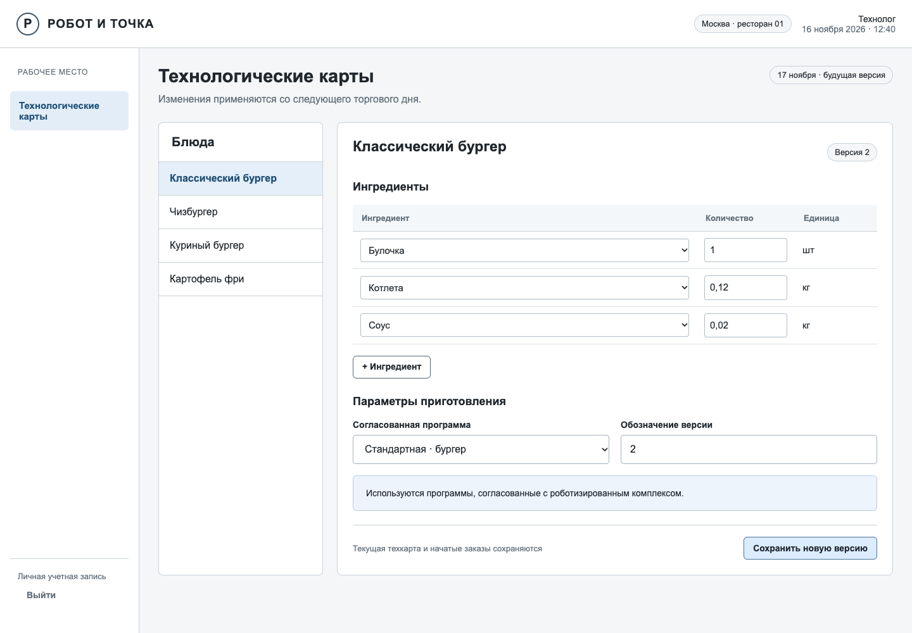{width="300"}](../assets/prototype/screens/r-06-default.png) | [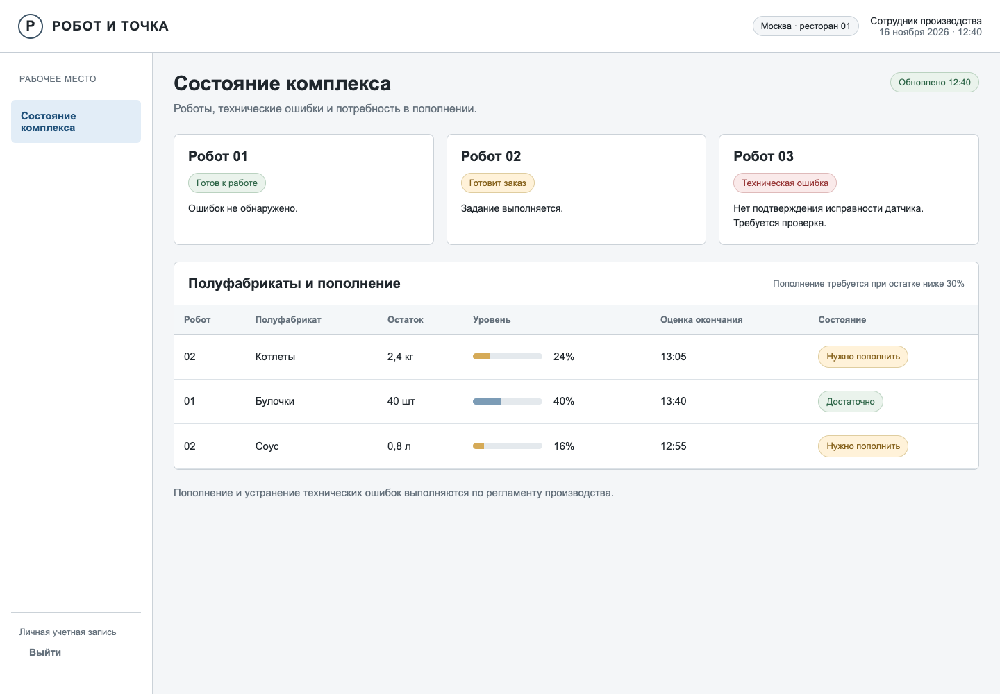{width="300"}](../assets/prototype/screens/r-07-default.png) |
| [Открыть прототип](../assets/prototype/index.html?screen=R-06) · Технолог · Первый релиз | [Открыть прототип](../assets/prototype/index.html?screen=R-07) · Сотрудник производства · Первый релиз |

**R-06, состояния:** [Ошибка количества](../assets/prototype/screens/r-06-validation.png) · [Карта еще не создана](../assets/prototype/screens/r-06-empty.png).

**R-07, состояния:** [Данные устарели](../assets/prototype/screens/r-07-stale.png) · [Нет подключенных роботов](../assets/prototype/screens/r-07-empty.png).

| **R-08 · Продажи и передача в 1С** |  |
|---|---|
| [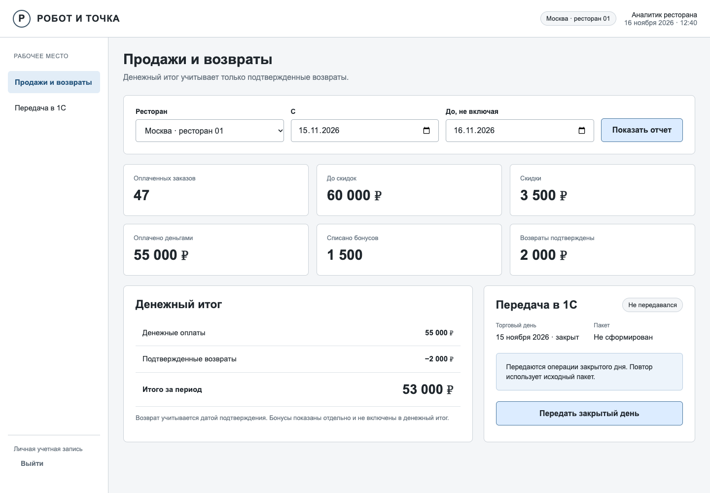{width="300"}](../assets/prototype/screens/r-08-default.png) |  |
| [Открыть прототип](../assets/prototype/index.html?screen=R-08) · Аналитик ресторана · Первый релиз |  |

**R-08, состояния:** [Пакет отправляется](../assets/prototype/screens/r-08-exportPending.png) · [Прием подтвержден](../assets/prototype/screens/r-08-exported.png) · [1С недоступна](../assets/prototype/screens/r-08-exportError.png) · [Нет операций](../assets/prototype/screens/r-08-empty.png).

## Сценарии для просмотра

1. **Покупка картой:** K-01 → K-02 → K-03. В корзине выбрать тип обслуживания, проверить расчет и подтвердить оплату. В K-04 выбрать результат терминала на панели демонстрации. Успех ведет в K-05, отказ возвращает к проверке заказа, неизвестный результат оставляет экран сверки.
2. **Сбой талона:** K-05 → ошибка принтера → K-06. В S-01 принять проблему, в S-02 проверить покупку и повторить печать прежнего талона. Код талона на экране сотрудника не показывается.
3. **Невозможность выполнения:** S-02 → причина и подтверждение отмены → регистрация внешнего ID возврата. Заказ отменен, деньги еще проверяются. Подтверждение результата моделируется отдельно. В первом релизе запуск возврата доступен в R-04.
4. **Выдача:** B-01 показывает две публичные колонки. В B-02 панель демонстрации моделирует действительный талон, частичный остаток, подтвержденный полный цикл, истечение срока и неисправность. Это сообщения внешнего комплекса; состав его оборудования остается допущением A-02.
5. **Первый релиз:** R-01 → подтверждение телефона → R-02 → подтверждение расчета и выбор способа оплаты. Для наличных R-03 отдельно показывает внесенную сумму, сдачу и неизвестный возврат неполной суммы. R-05–08 демонстрируют рабочие формы соответствующих ролей.
